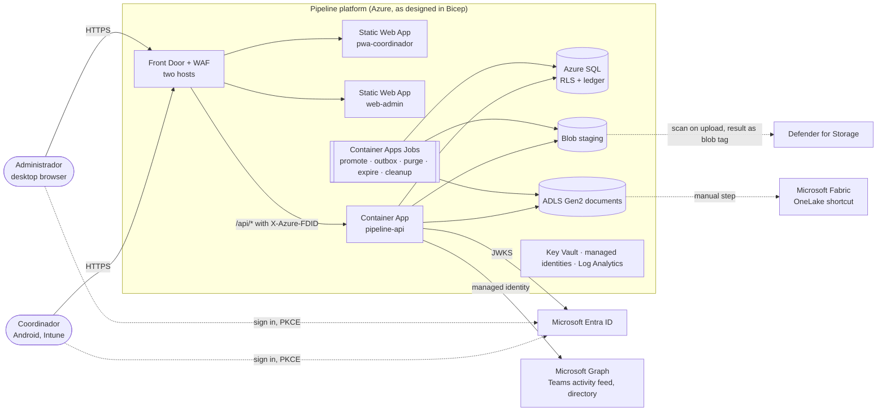
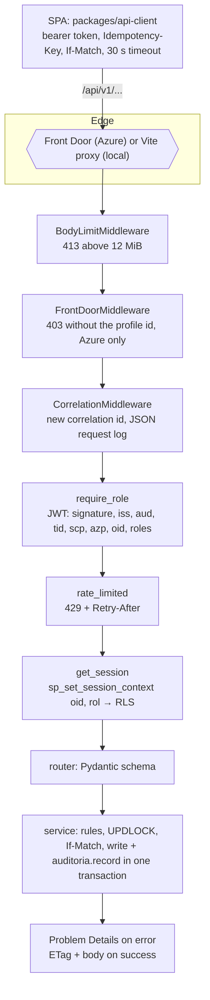
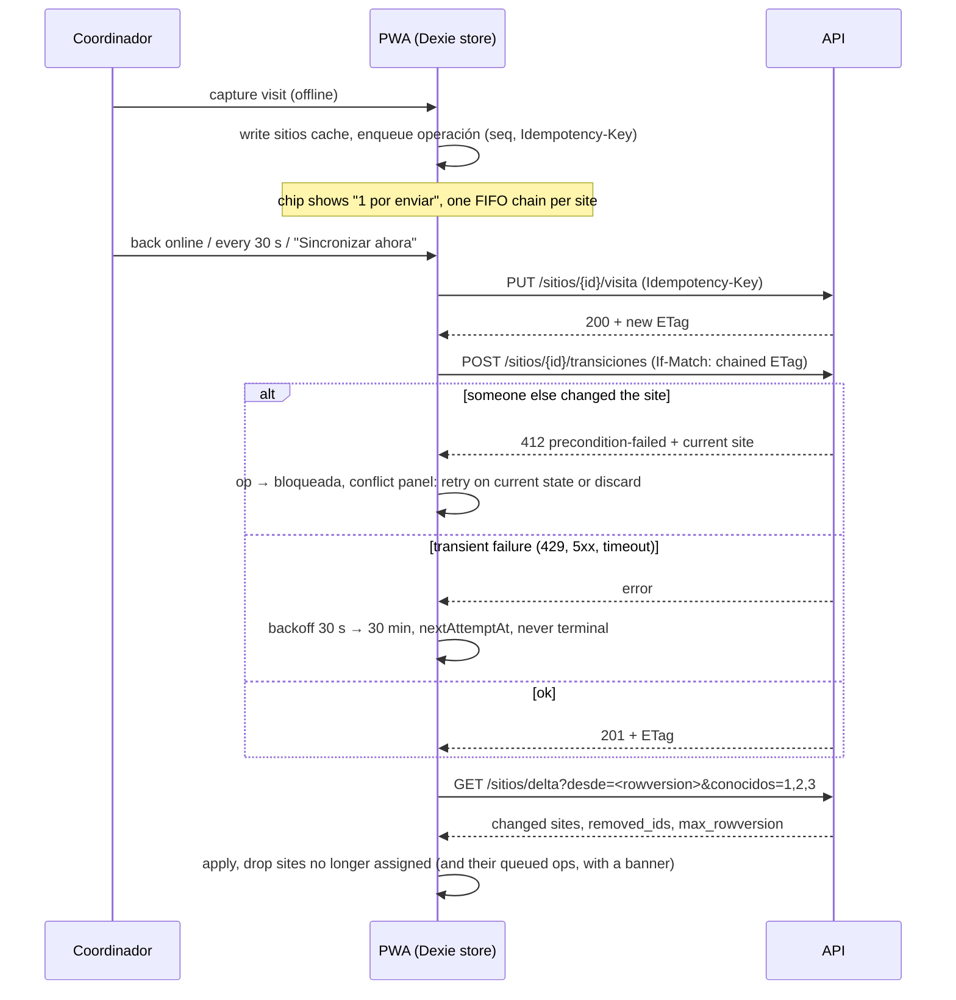

# Pipeline de Posibles Tiendas

**Store-site pipeline for Tiendas 3B.** Regional coordinators work candidate store sites from managed
Android phones with an offline-first web app; an administrator loads sites in bulk, reviews quality,
returns sites with a reason, reassigns them, and reads an append-only audit log. One FastAPI service,
one SQL database with row-level security, two React apps, Microsoft Entra ID for identity, and Azure
infrastructure described in Bicep.

**Status (11 October 2026).** Every quality gate that can run without an Azure subscription is green
on the production artefacts: the container image without development dependencies and the built PWA
under the Static Web App security policy. The Azure deployment path is written and statically
validated but **has never run against a subscription**; the prerequisites and the first-deployment
checklist are in [`docs/RELEASE_READINESS.md`](docs/RELEASE_READINESS.md). Nothing in this
repository is described as running in Azure until it has.

## Contents

- [What it is](#what-it-is)
- [Quick start](#quick-start)
- [How it works](#how-it-works)
- [Component reference](#component-reference)
- [Repository structure](#repository-structure)
- [Configuration reference](#configuration-reference)
- [Usage guide](#usage-guide)
- [Data and integrations](#data-and-integrations)
- [Development guide](#development-guide)
- [Testing and quality assurance](#testing-and-quality-assurance)
- [Deployment and operations](#deployment-and-operations)
- [Security and privacy](#security-and-privacy)
- [Troubleshooting and FAQ](#troubleshooting-and-faq)
- [Limitations and roadmap](#limitations-and-roadmap)
- [Additional resources](#additional-resources)

## What it is

### The problem

Tiendas 3B scouts candidate locations for new stores. A national spreadsheet lists the candidates;
regional **coordinadores** visit them, locate the owner, measure the frontage, photograph the site and
collect four legal documents; an **administrador** controls data quality, returns bad captures and
keeps the coordinator roster. Until now that work lived in spreadsheets and chat, with no audit
trail, no offline capture and no single source of truth. The original requirements are the TDD
(`TDD_Pipeline_Tiendas_v0.1.pdf`) and the design review (`Propuesta_mejoras_TDD_v0.1.md`).

### Who uses it

| Role | Where | What they do | Entra role |
|---|---|---|---|
| Coordinador (about ten people) | Android phone managed by Intune, PWA installed from the browser | Sees only their own sites. Captures contact, visit, photos and PDFs; advances the site one stage at a time; receives returns and notices. Works without signal. | `Coordinador` |
| Administrador (one or two people) | Desktop browser | Loads the national file, reviews the queue, returns or discards sites with a reason, reassigns coordinators, maintains code-to-account equivalences, reads the audit ledger. | `Admin` |
| TI, Identidad, Seguridad | Azure portal, GitHub | Provide the subscription, Entra registrations, Defender, immutability policy; operate with the runbooks. | none |
| Fabric analysts | Microsoft Fabric | Read the documents through a OneLake shortcut (designed; not yet wired). | none |

### What it does

- **Fixed site workflow.** `sitio_prospectado` → `dueno_localizado` → `primera_visita` →
  `recepcion_documentos`. Each step has requirements enforced by the API (contact with name and
  phone; frontage and depth above zero; every required document published). A coordinator can
  propose a discard; the administrator decides.
- **Offline-first capture.** The PWA stores the coordinator's sites locally, queues every change,
  replays it when the network returns and reconciles conflicts with per-site ETags. Photos are
  compressed on the phone; PDFs upload in resumable 4 MiB parts when online.
- **Bulk load with review.** The administrator uploads the national `.xlsx`, `.csv` or legacy `.xls`;
  rows are validated into a staging lot, warnings are approved or excluded row by row, and the lot is
  confirmed in one transaction. Sites that already advanced are never regressed by a reload.
- **Returns, discards, reassignment** with mandatory reason and comment, an in-app notice feed, and
  Teams activity-feed delivery when Microsoft Graph is configured.
- **Tamper-evident audit.** Every write and every file download appends to SQL Server ledger
  tables that the application login cannot update or delete.
- **Document pipeline.** Uploads land in a staging container, are checked for size, type by
  signature, page count and SHA-256, wait for a Microsoft Defender scan result, then are promoted to a
  documents account meant to be exposed to Fabric. Retention purge keeps metadata and deletes bytes.

### Guarantees the code enforces

| Guarantee | Mechanism |
|---|---|
| A coordinator can only ever read or write their own sites | SQL Server row-level security keyed on the connection's `SESSION_CONTEXT` (`oid`, `rol`); the API sets it on every checkout. A foreign site is a 404. |
| Nobody can edit history | Ledger tables (`APPEND_ONLY`) for audit, status history; `UPDATE`/`DELETE` revoked from the app login. |
| Two devices cannot silently overwrite each other | `rowversion` ETags, `If-Match` on transitions and admin actions (412 with the current state, 428 when missing), `UPDLOCK` row locks on every mutating path. |
| A replayed request does not double-apply | `Idempotency-Key` store per user, 7-day retention; same key and body replays the stored response. |
| Oversized or malformed input never reaches business code | 12 MiB body cap before the app reads anything; workbook row count read from the sheet's dimension tag before parsing; file type by signature; PDF page and encryption checks. |
| Abuse is bounded | Per-user sliding-window rate limits per route family (429 with `Retry-After`); only Front Door may reach `/api/*` in production (`X-Azure-FDID`). |
| Every error is traceable without leaking data | RFC 9457 Problem Details with a server-generated correlation id, written to the audit row and the JSON log; names, phones, emails, tokens and bodies are redacted from logs. |

### Limitations you should know before starting

- No Azure environment has been deployed. Entra sign-in, Defender scanning, Teams delivery, Front
  Door validation and the Fabric shortcut are implemented and unit-tested against substitutes, not
  exercised against the real services.
- The status `entregado` exists in the catalogue but no code path assigns it (business decision
  pending).
- Rate limits are per process replica, not shared.
- Legacy `.xls` parsing has been tested with generated files only.
- There is no privacy notice before the coordinator captures an owner's contact data (legal text
  pending).

## Quick start

Everything runs on one machine with local substitutes for every Azure service. No Azure account,
credentials or network access to Microsoft are needed.

### Prerequisites

| Tool | Version | Why |
|---|---|---|
| Docker Engine with Compose v2 | tested with 29 / 2.27 | SQL Server 2022, Azurite, the dev identity provider, the API and the job scheduler run as containers |
| Node.js | 22 | Front-end dev servers, unit tests, Playwright. `corepack enable pnpm` installs the pinned pnpm 12.11 |
| `make`, `curl` | any | Entry points and health checks |
| Python 3.12 with `openpyxl` | optional | Only to regenerate the synthetic sample (`samples/generate_sample.py`); the API runs inside Docker |
| Bicep CLI | optional | `make bicep-lint` |

Disk: about 3 GB of images, 1 GB of `node_modules`, 200 MB for Playwright's Chromium. SQL Server
needs about 2 GB of RAM.

### 1. Start the platform

```bash
git clone git@github.com:kurte32/ade_pipe.git && cd ade_pipe
cp .env.example .env     # development-only values; see "Configuration reference"
make up                  # builds the API image, starts the five services, applies migrations, waits for health
make db-seed             # ten coordinator equivalences and 87 synthetic sites through the real bulk-load path
```

`make up` runs, in order: `db-init` (creates the `pipeline` database and the least-privilege login
`pipeline_app`), `alembic upgrade head` (schema, RLS policy, ledger tables, grants, catalogue
seeds), then the API with hot reload and the scheduler loop. First start of SQL Server takes 20 to
40 seconds.

### 2. Start the apps

Pick one:

```bash
# A. Dev servers on the host with hot reload (what the team uses)
corepack enable pnpm && pnpm install
pnpm dev                 # PWA http://localhost:5173 · admin http://localhost:5174

# B. Everything in Docker, including the two front-ends
make up-web
```

With nvm, run `nvm use 22` first in every shell that runs `pnpm` or `make e2e`.

### 3. Verify

```bash
make health
```

Expected: `/healthz` answers `{"status":"ok"}` and `/readyz` answers

```json
{"database":"ok","schema_revision":"e5f6a7b8c9d0","schema_head":"e5f6a7b8c9d0","schema":"ok","storage":"ok","status":"ok"}
```

`schema_revision` is the Alembic revision applied to the database and `schema_head` the one this
code ships; they match on a fresh stack.

| Service | Local URL |
|---|---|
| PWA coordinador | http://localhost:5173 |
| Web admin | http://localhost:5174 |
| API | http://localhost:8000 (OpenAPI UI at `/api/docs`, local only) |
| Health | http://localhost:8000/healthz · http://localhost:8000/readyz |
| Dev identity provider | http://localhost:8001 (`/users`, `/token`, JWKS) |
| SQL Server · Azurite | `localhost:1433` · `http://localhost:10000/devstoreaccount1` |

All ports bind to `127.0.0.1` only.

### 4. First task in the UI

1. Open http://localhost:5174, pick `adm` in the development user picker. The dashboard shows the
   seeded sites by status and the review queues. Open **Cargas** to see the seeded lot.
2. Open http://localhost:5173, pick `ard`. **Mis sitios** lists Ana Rodríguez's eight sites. Open one,
   fill **Contacto del dueño** (name and phone), then **Avanzar** moves it to `dueno_localizado`.
3. Back in the admin, open the same site and **Devolver** it with a reason. In the PWA, **Avisos**
   shows the return and the site shows `Devuelto` with the reason.
4. Turn the phone emulation offline in DevTools, capture a visit, go online: the sync chip drains the
   queue and the admin sees the change.

Dev users: `ard` to `jdc` are coordinators, `adm` is the administrator, `xna` has no role (exercises
the 403 path). Tokens are real RS256 JWTs with Entra v2 claims minted by `tools/dev-idp`; the API
validates them exactly as it validates Entra tokens.

### 5. First task through the API

```bash
TOKEN=$(curl -s http://localhost:8001/token -H 'content-type: application/json' \
  -d '{"user_code":"ard","client_id":"33333333-3333-4333-8333-333333333333"}' | jq -r .access_token)

curl -s http://localhost:8000/api/v1/me -H "authorization: Bearer $TOKEN"
# {"oid":"a0000000-0000-4000-8000-000000000001","name":"Ana Rodríguez Díaz","username":"ard@dev.tiendas3b.test","roles":["Coordinador"]}

curl -s http://localhost:8000/api/v1/sitios/resumen -H "authorization: Bearer $TOKEN"
# {"sitio_prospectado":8}

curl -s 'http://localhost:8000/api/v1/sitios?limit=2' -H "authorization: Bearer $TOKEN" | jq '.items[0], .next_cursor'
# {"id":1,"origen_id":566,"nombre":"Av. 20 de Noviembre 668","region":"Xalapa","estatus":"sitio_prospectado", ..., "etag":"00000000000007d2"}
# "Ng"
```

The outputs above were captured on the seeded local stack. More calls, including a conditional
transition and a bulk load, are in the [Usage guide](#usage-guide).

### 6. Run the gates

```bash
make test                # backend unit + integration tests against the running stack
pnpm test                # frontend unit tests (Vitest) in packages and apps
make lint                # ruff, mypy strict, eslint, tsc
make e2e                 # Playwright against the dev servers (pnpm dev must be running)
```

Stop with `make down` (keeps data) or `make reset` (deletes database, blobs and the dev signing key).

## How it works

### System context



Locally the same code runs with substitutes: Vite's dev server proxies `/api` and `/dev-idp` instead
of Front Door, SQL Server 2022 in Docker instead of Azure SQL, Azurite instead of both storage
accounts, `tools/dev-idp` instead of Entra, and `SCAN_MODE=none`, `NOTIFY_MODE=log`,
`DIRECTORY_MODE=dev` instead of Defender and Graph. Business logic never branches on the
environment; only adapters do ([`docs/ENVIRONMENTS.md`](docs/ENVIRONMENTS.md)).

The dotted edges (Defender, Fabric, Entra sign-in) and everything inside the Azure box are designed
and statically validated, not yet verified in a deployed environment.

### Architectural style

A **modular monolith**: one FastAPI service, one database, one container image. Background work is
five idempotent jobs started from the same image. No microservices, message broker or Kubernetes;
with ten users and a few hundred sites, they would add failure modes without adding value
([`architecture/ADR/ADR-001-compute.md`](architecture/ADR/ADR-001-compute.md), "considered and
rejected" in [`architecture/TO_BE.md`](architecture/TO_BE.md) §8).

### How a request is handled



1. The SPA calls its own origin; Front Door or the Vite proxy forwards `/api/*`.
2. Oversized bodies are rejected before anything is read. In Azure, requests without the Front Door
   profile id are refused.
3. A correlation id is generated server-side (never taken from the client), bound to the log
   context and returned as `X-Correlation-Id`.
4. The bearer token is validated against the JWKS (one-hour cache). The caller's identity is the
   `oid` claim only; the route decides which role is acceptable and that role becomes the RLS
   context.
5. The database session has already executed `sp_set_session_context` for `oid` and `rol`; every
   query is filtered by row-level security from here on. Jobs use the all-zero `SYSTEM_OID` with
   role `Sistema`.
6. The service enforces business rules, takes an `UPDLOCK` on the site, re-reads it, compares
   `If-Match`, writes, appends the audit row in the same transaction and returns the new ETag.
7. Any failure becomes RFC 9457 Problem Details with the correlation id; unhandled exceptions never
   carry their text.

### How the PWA stays correct offline



The store belongs to one account: signing in with a different account clears it. Signing out
("Salir") clears everything including unsent captures, so the shell asks for confirmation when the
queue is not empty. The service worker precaches the shell (`js`, `css`, `html`, `svg`, `woff2`)
and never caches or syncs API data; it cannot obtain tokens. Details and invariants:
[`docs/DEVELOPER_GUIDE.md`](docs/DEVELOPER_GUIDE.md) §4 and `apps/pwa-coordinador/src/sync/engine.test.ts`.

### How a bulk load works

1. `POST /admin/cargas` receives the file (first sheet, at most 10 MB and 5,000 rows; a workbook
   whose dimension tag declares more rows is refused before parsing).
2. Every row is validated into `carga_fila_staging` with a result (`ok`, `advertencia`, `error`),
   the reasons, and the planned action (`insertar`, `actualizar`, `revision`). Values are stored as
   the file has them.
3. The administrator reviews the lot page by page, approves or excludes warning rows.
4. `confirmar` runs in one transaction under a lot lock: new `#` become `sitio_prospectado` owned by
   the coordinator whose `USUARIO` code has an active equivalence; existing sites get their file
   fields updated; a site that already advanced is never regressed, and a change of owner moves
   contact, visit, files, open uploads and pending notices with it. Rows that would alter an advanced
   site go to the admin review queue instead.

### How a document travels

`POST /subidas` opens a session → `PUT /subidas/{id}/partes/{n}` streams 4 MiB parts to the staging
container → `POST /subidas/{id}/completar` verifies size, SHA-256, real type, PDF page count and
encryption, then either publishes at once (`SCAN_MODE=none`) or answers 202 `escaneando` until
Defender writes its result tag; the `promote` job copies the blob to the documents account, records
`sitio_archivo` (one `vigente` copy per document type, earlier versions kept) and bumps the site so
other devices see it. Downloads go through the API (`GET /archivos/{id}`), are audited before the
first byte and never expose a storage URL. The `purge` job deletes bytes after `purga_utc`
(retention 5 years by default) and keeps the metadata.

## Component reference

### Front-end

| Component | What and why | Where | Talks to | Configuration | Failure behaviour |
|---|---|---|---|---|---|
| **pwa-coordinador** | The coordinator's app: site list, detail with stage checklist, contact, visit, photos, PDFs, discard proposal, notices, sync chip and conflict panel. Installable PWA so it survives no signal. | `apps/pwa-coordinador` (pages `MisSitios`, `SitioDetalle`, `Notificaciones`; `sync/`, `upload/`, `db/`) | API via `packages/api-client`; Dexie (IndexedDB) tables `sitios`, `operaciones`, `fotos`, `meta`; Web Locks to serialise tabs | `.env.development` (dev ids) or `config.json` next to the bundle; CSP and headers in `public/staticwebapp.config.json` | Offline or 401: sync pauses, banner, queue kept. 412/422/404/409/410: op blocked with the server state. 5xx/429/timeout: backoff. Reassigned site: dropped with its ops and a banner. |
| **web-admin** | The administrator's app: dashboard with server-side queues, sites table (cards on phones), site detail with return, discard, reassign, history and files; loads with row review; equivalences; audit log with plain-language action labels. | `apps/web-admin` (pages `Resumen`, `Sitios`, `SitioDetail`, `Cargas`, `CargaDetail`, `Equivalencias`, `Auditoria`) | API via `packages/api-client` | same mechanism as the PWA, admin client id | 412 reloads the site and shows the change; config errors render a message instead of a blank page |
| **packages/auth** | One `AuthProvider` with two implementations: `dev` (picker against `tools/dev-idp`) and `msal` (MSAL Browser 4, PKCE, redirect). Loads per-environment ids from `config.json` at runtime so one bundle serves every environment. | `packages/auth/src` (`runtime.ts`, `dev.ts`, msal provider) | dev-idp `/users`, `/token`; Entra | `VITE_AUTH_MODE` (build time), `VITE_TENANT_ID`, `VITE_SPA_CLIENT_ID`, `VITE_API_CLIENT_ID`, `VITE_API_BASE_URL` (runtime) | MSAL errors map to "offline" or "sign in again"; the auth mode cannot be changed by `config.json` |
| **packages/api-client** | Typed fetch wrapper generated from `docs/openapi.json`: bearer header, `Idempotency-Key`, `If-Match`, Problem Details parsing (`ApiError.slug`, `current`), 30 s timeout. | `packages/api-client/src` (`client.ts`, `problem.ts`, `generated/schema.ts`) | API | `VITE_API_BASE_URL` when the API is not same-origin | Timeout is a transient `NetworkError`; the caller's own abort is rethrown |
| **packages/ui** | Design tokens (`base.css`), shared components (`AppBar`, `PageHeader`, `Alert`, `Field`, `Modal` with focus trap, `StageIndicator`, `EstatusBadge`, `EmptyState`), Spanish label maps for every API code. | `packages/ui/src` | none | none | n/a |

### Backend core (`backend/app/core`)

| Module | Responsibility | Key settings |
|---|---|---|
| `config.py` | Typed settings from the environment; the **deployment guard** refuses to start any non-`local` environment with development modes (dev auth, SQL auth, Azurite, placeholder tenant, missing admin client id; production also needs Front Door, Defender, Graph) | everything in [Configuration reference](#configuration-reference) |
| `security.py` | JWT validation (RS256, `iss`, `aud`, `tid`, `scp`, `azp`, `oid`), role mapping, `require_role` that also fixes the RLS role for the request | `AUTH_*` |
| `db.py` | Engine with Entra token or SQL auth, session per request with `sp_set_session_context`, certificate trust only in `local`, parameters hidden from logs | `DB_*` |
| `edge.py` | `FrontDoorMiddleware`: `/api/*` must carry `X-Azure-FDID` equal to the profile id; probes exempt | `FRONT_DOOR_ID` |
| `ratelimit.py` | In-process sliding window per user per route family; 429 with `Retry-After` | `RATE_LIMIT_*_PER_MINUTE` |
| `limits.py` | Body cap before reading; chunked overflow answers 413 Problem Details | `MAX_REQUEST_BYTES` |
| `idempotency.py` | `run_once`: claims the key, stores the response, replays it; 422 on a different body, 409 while in flight | `IDEMPOTENCY_TTL_DAYS` |
| `errors.py` | `AppError` and every exception class to Problem Details; database outages become 503 `service-unavailable` with `Retry-After` | |
| `logging.py` | JSON lines with correlation id, route, method, status, `duration_ms`, hashed user, entity ids, revision; redaction of personal keys | `LOG_LEVEL` |
| `storage.py` | `BlobStore` over Azurite or Azure (managed identity): block upload, server-side copy, tags, range reads | `STORAGE_*` |
| `telemetry.py` | OpenTelemetry to Application Insights when configured | `APPLICATIONINSIGHTS_CONNECTION_STRING` |

### Backend modules (`backend/app/modules/<name>/{router,service,schemas}.py`)

| Module | Owns | Inputs → outputs | Notes |
|---|---|---|---|
| `identity` | `/me`, token claims, dev admin claims for jobs | bearer → `{oid, name, username, roles}` | Roles other than `Admin`/`Coordinador` are dropped |
| `sitios` | List with filters and queues, detail with ETag, history, `delta` sync, `resumen`, `cambiar_propietario` | query → `SitioDetail`, `{items, next_cursor}`, `{items, removed_ids, max_rowversion}` | Site ids are 32-bit; larger is 422 |
| `transiciones` | The state machine: `avanzar`, discard proposal, admin `devolver`/`descartar`/`reasignar`; rules in `rules.py` | body + `If-Match` → `SitioDetail` + ETag, or 422 with `faltantes` | Lock, re-read, then compare `If-Match` |
| `cargas` | Parser (`csv`, `xlsx`, `xls`), row validation codes, staging, decisions, confirm, cancel | multipart → `LoteSummary`, `LoteDetail`, `ConfirmResult` | Dimension-tag row check; lot locked on confirm |
| `archivos` | Upload sessions, parts, complete, scan wait, promote, download with `Range`, soft delete, `meta` | see [How a document travels](#how-a-document-travels) | One `vigente` per document type (filtered unique index) |
| `notificaciones` | Outbox rows on return, in-app feed, read marker, Graph sender | `GET /notificaciones`, `POST …/leer` | Delivery never blocks the return transaction |
| `auditoria` | `record()` used by every write; admin query with filters | filters → `{items, next_cursor}` | Ledger table; the label map lives in `packages/ui/src/labels.ts` |
| `equivalencias` | Coordinator code ↔ email ↔ `oid` roster, resolved through the directory (dev-idp or Graph); dev seed | `PUT /admin/equivalencias` all-or-nothing | A reassignment target must have an active equivalence |

### Jobs (`backend/app/jobs`)

| Job | Purpose | Local interval (`scheduler.py`) | Azure schedule (Bicep, not yet run) | Failure handling |
|---|---|---|---|---|
| `promote` | Publish uploads whose scan result arrived | 15 s | every minute | Waits; warns past `SCAN_WAIT_SECONDS` (900) |
| `outbox` | Deliver notices (Graph or log); claims rows with `UPDLOCK, READPAST`, commits per row | 20 s | every minute | Exponential backoff, `fallida` after 8 attempts, outcomes audited |
| `expire_uploads` | Expire sessions older than `UPLOAD_SESSION_TTL_HOURS` (72) and delete staging blobs | 10 min | every 10 min | Idempotent, audited |
| `purge` | Delete document bytes past `purga_utc`, keep metadata | hourly | daily | 403/409 from an immutability policy or legal hold is recorded as `purga_bloqueada`; other errors raise |
| `idempotency_cleanup` | Delete replay records older than `IDEMPOTENCY_TTL_DAYS` (7) | hourly | daily | Idempotent |

Run one by hand with `make job-<name>` locally; in Azure each is a Container Apps Job. All jobs run
as `Sistema`, which the RLS predicate accepts.

### Local development services (`docker-compose.yml`)

| Service | Image | Role |
|---|---|---|
| `sqlserver` | `mcr.microsoft.com/mssql/server:2022-CU27-ubuntu-22.04` (pinned, same as CI) | Database with RLS, ledger tables, `rowversion` |
| `azurite` | `mcr.microsoft.com/azure-storage/azurite:3.35.0` (pinned) | Both blob containers in one emulated account |
| `dev-idp` | built from `tools/dev-idp` | OIDC issuer: `/users`, `/token`, discovery, JWKS; RS256 key in the `devidpkeys` volume |
| `api` | built from `backend/Dockerfile` with `INSTALL_DEV=true`, bind-mounted at `/app` | FastAPI with hot reload |
| `scheduler` | same image | `python -m app.jobs.scheduler` interval loop |
| `pwa`, `admin` (profile `web`) | `node:22-bookworm` | Dev servers in containers for `make up-web` |

### Infrastructure (`infra/bicep`, statically validated only)

`main.bicep` composes 14 modules: `network` (VNet, subnets, private DNS, NSG), `monitoring`
(Log Analytics, Application Insights, action group and four alert rules), `identity` (user-assigned
identities for the API and the migrate job), `keyvault`, `storage` (staging and ADLS Gen2 documents
accounts, Defender, container-level immutability), `sql` (server, database, Entra-only admin,
firewall rule for dev), `acr`, `staticwebapps`, `frontdoor-profile` (profile, two endpoints, WAF,
diagnostics, outputs the id the API validates), `containerapps` (environment, API app with 0 %
revision rollout, migrate job, scheduled jobs), `frontdoor` (routes), `fabricgateway` (manual
step), `acadns`, `rglock`. Parameters per environment in `params/{dev,test,prod}.bicepparam` still
hold placeholder GUIDs. `bash infra/bicep/validate.sh` builds and lints everything without a
subscription.

## Repository structure

```text
.
├── apps/
│   ├── pwa-coordinador/        React PWA · src/pages, components, sync/ (engine, context), upload/, db/ (Dexie), lib/
│   │   └── public/staticwebapp.config.json   SWA routes, CSP and security headers (also served by vite preview)
│   └── web-admin/              React admin · src/pages, lib/, admin.css
├── packages/
│   ├── ui/                     design tokens (base.css), shared components, labels.ts
│   ├── auth/                   AuthProvider (dev, msal), runtime config.json loader
│   └── api-client/             typed fetch wrapper, Problem Details, generated OpenAPI types
├── backend/
│   ├── app/main.py             FastAPI factory: middleware order, /healthz, /readyz, /healthz/deps, routers
│   ├── app/core/               config, db, security, errors, edge, ratelimit, limits, idempotency, logging, storage, telemetry, clock
│   ├── app/modules/            identity, sitios, transiciones, cargas, archivos, notificaciones, auditoria, equivalencias
│   ├── app/jobs/               promote, outbox, expire_uploads, purge, idempotency_cleanup, scheduler, run
│   ├── app/models.py           SQLAlchemy models (DATETIME2(3) timestamps, rowversion, filtered unique index)
│   ├── app/cli.py              db-init · seed · openapi · e2e-cleanup
│   ├── migrations/             Alembic: baseline (RLS, ledgers, grants, catalogues) + 4 incremental revisions
│   ├── tests/unit/             no database
│   ├── tests/integration/      against the compose stack (fixtures in tests/conftest.py)
│   ├── Dockerfile              digest-pinned python:3.12-slim, ODBC 18, uv, non-root, ENVIRONMENT=production
│   └── pyproject.toml, uv.lock
├── e2e/                        Playwright: tests/pwa.*.spec.ts, tests/admin.*.spec.ts, global-setup (site pool), tools/ (screenshots, net-timing)
├── tools/dev-idp/              local OIDC issuer and users.json (never deployed)
├── infra/bicep/                main.bicep, rg.bicep, modules/ (14), params/ (dev, test, prod), validate.sh
├── .github/workflows/          ci.yml · build-deploy.yml · deploy-environment.yml (reusable) · drift.yml
├── samples/                    generate_sample.py and the synthetic national file (Anexo A layout)
├── architecture/               AS_IS, TO_BE, AZURE_DESIGN, SECURITY, ADR/ (10), IMPLEMENTATION_PLAN, RISK_REGISTER, PRODUCTION_READINESS
├── docs/                       guides (see Additional resources), openapi.json, audit/, ux/
├── docker-compose.yml, Makefile, .env.example, .gitleaks.toml
├── CHANGELOG.md                what shipped, by branch and date
└── TDD_Pipeline_Tiendas_v0.1.pdf, Guia_Integracion_Entra_ID_React_FastAPI.pdf, Propuesta_mejoras_TDD_v0.1.md   source documents (Spanish)
```

## Configuration reference

All backend configuration comes from environment variables read by `backend/app/core/config.py`
(pydantic-settings, case-insensitive, no `.env` file is read by the app itself: Compose injects
`.env`, Azure injects Container App settings and Key Vault references). `.env.example` documents the
local value of every variable the stack needs; copy it, do not edit the example.

> **Never put real secrets in `.env.example` or in Bicep parameters.** Locally the passwords and the
> Azurite key are the public, well-known development values. In Azure, SQL and storage use managed
> identity (no password at all) and the only secret, the Application Insights connection string, is a
> Key Vault reference.

### Environments and the deployment guard

| `ENVIRONMENT` | Where | What the guard requires at start-up |
|---|---|---|
| `local` (default) | Compose stack, CI | Nothing. The only value that may trust the SQL certificate, serve `/api/docs`, accept `tools/dev-idp` and run `e2e-cleanup`. |
| `test` | Azure dev and UAT | `AUTH_MODE=entra`; `AUTH_ISSUER` and `AUTH_JWKS_URL` on `login.microsoftonline.com`; a real `AUTH_TENANT_ID`; `DB_AUTH=entra`; `STORAGE_MODE=azure`; `AUTH_ALLOWED_AZP` and `AUTH_ADMIN_AZP` set; `TEAMS_APP_ID` when `NOTIFY_MODE=graph`. |
| `production` | Azure prod | Everything above plus `FRONT_DOOR_ID`, `SCAN_MODE=defender`, `NOTIFY_MODE=graph`, `DIRECTORY_MODE=graph`. |

The image sets `ENVIRONMENT=production` by default, so a container started without configuration
refuses to start rather than running with development settings.

### Backend variables

Required means no default in code. Secret-bearing variables are marked 🔑.

| Variable | Default | Values / notes |
|---|---|---|
| `ENVIRONMENT` | `local` | `local`, `test`, `production` |
| `LOG_LEVEL` | `INFO` | Python level name |
| `APP_PUBLIC_URL` | `http://localhost:5173` | PWA URL used in notice links |
| `DB_HOST`, `DB_PORT`, `DB_NAME` | `localhost`, `1433`, `pipeline` | Compose overrides the host to `sqlserver` for containers |
| `DB_AUTH` | `sql` | `sql` (login + password) or `entra` (managed-identity token) |
| `DB_USER` | `pipeline_app` | Least-privilege login created by `db-init`; in Azure the API identity name |
| `DB_PASSWORD` 🔑 | empty | Required with `DB_AUTH=sql` |
| `DB_ADMIN_USER`, `DB_ADMIN_PASSWORD` 🔑 | `sa`, empty | Only for `db-init` and migrations locally; unset in Azure |
| `DB_POOL_SIZE`, `DB_MAX_OVERFLOW` | `5`, `10` | SQLAlchemy pool |
| `AUTH_MODE` | `dev` | `dev` or `entra` |
| `AUTH_TENANT_ID` | **required** | Tenant GUID; placeholders refused when deployed |
| `AUTH_AUDIENCE` | **required** | Client id of the API registration |
| `AUTH_ISSUER` | **required** | `https://login.microsoftonline.com/<tenant>/v2.0` in Azure; dev-idp URL locally |
| `AUTH_JWKS_URL` | **required** | Entra discovery keys URL in Azure |
| `AUTH_ALLOWED_AZP` | empty | Comma-separated SPA client ids allowed to call the API |
| `AUTH_ADMIN_AZP` | empty | The admin SPA's client id; `Admin` is honoured only from it |
| `AUTH_REQUIRED_SCOPE` | `access_as_user` | Scope the token must carry |
| `DEV_IDP_URL` | `http://localhost:8001` | Local issuer and directory (`DIRECTORY_MODE=dev`) |
| `CORS_ALLOWED_ORIGINS` | empty | Comma-separated origins; only when the SPAs are not behind Front Door (dev without it) |
| `FRONT_DOOR_ID` | empty | Front Door profile id; when set, `/api/*` needs a matching `X-Azure-FDID` |
| `RATE_LIMIT_CAPTURES_PER_MINUTE` | `300` | Per user, per replica; `0` disables |
| `RATE_LIMIT_TRANSITIONS_PER_MINUTE` | `300` | |
| `RATE_LIMIT_UPLOADS_PER_MINUTE` | `120` | `POST /subidas` |
| `RATE_LIMIT_UPLOAD_PARTS_PER_MINUTE` | `1200` | |
| `RATE_LIMIT_LOADS_PER_MINUTE` | `30` | |
| `STORAGE_MODE` | `azurite` | `azurite` (endpoint + key) or `azure` (account URLs + managed identity) |
| `STORAGE_BLOB_ENDPOINT`, `STORAGE_ACCOUNT_NAME`, `STORAGE_ACCOUNT_KEY` 🔑 | Azurite defaults, key empty | Azurite's published development key goes in `.env` |
| `STORAGE_STAGING_ACCOUNT_URL`, `STORAGE_DOCUMENTS_ACCOUNT_URL` | empty | Azure only (Bicep outputs) |
| `STORAGE_STAGING_CONTAINER`, `STORAGE_DOCUMENTS_CONTAINER` | `staging`, `documents` | |
| `SCAN_MODE` | `none` | `none` or `defender`; production requires `defender` |
| `SCAN_WAIT_SECONDS` | `900` | After this, a session still `escaneando` is logged as a warning |
| `NOTIFY_MODE` | `log` | `log` or `graph` (Teams activity feed) |
| `DIRECTORY_MODE` | `dev` | `dev` (dev-idp users) or `graph` |
| `GRAPH_BASE_URL` | `https://graph.microsoft.com/v1.0` | |
| `TEAMS_APP_ID` | empty | Required with `NOTIFY_MODE=graph` |
| `APPLICATIONINSIGHTS_CONNECTION_STRING` 🔑 | empty | Key Vault reference in Azure |
| `PDF_MAX_BYTES`, `PDF_MAX_PAGES` | `157286400` (150 MiB), `50` | |
| `UPLOAD_CHUNK_BYTES` | `4194304` (4 MiB) | Part size announced to the client |
| `PHOTO_MAX_BYTES` | `1572864` (1.5 MiB) | After on-device compression |
| `LOAD_MAX_ROWS`, `LOAD_MAX_BYTES` | `5000`, `10485760` (10 MiB) | Bulk load |
| `MAX_REQUEST_BYTES` | `12582912` (12 MiB) | Hard cap on any body; must exceed `LOAD_MAX_BYTES` plus multipart overhead and `UPLOAD_CHUNK_BYTES` |
| `TRUSTED_PROXY_HOPS` | `0` | Proxies that append to `X-Forwarded-For`: 2 behind Front Door, 1 on Container Apps alone, 0 = socket peer |
| `DUPLICATE_DISTANCE_METERS` | `15` | Nearby-site warning in loads |
| `SUSPICIOUS_NAME_WORDS` | `prueba,viable,equivocado,ubicacion,ubicación,test` | Name warning in loads |
| `UPLOAD_SESSION_TTL_HOURS` | `72` | |
| `IDEMPOTENCY_TTL_DAYS` | `7` | |
| `RETENTION_YEARS` | `5` | Sets `purga_utc` on published documents |

Compose-only variables in `.env`: `SQL_SA_PASSWORD` 🔑 (baked into the `sqldata` volume on first
start), `DEV_IDP_PUBLIC_URL`, and the host ports `SQL_PORT`, `AZURITE_PORT`, `DEV_IDP_PORT`,
`API_PORT`. Azure-only: `AZURE_CLIENT_ID` selects the user-assigned identity for
`DefaultAzureCredential`.

### Front-end variables

| Variable | When | Meaning |
|---|---|---|
| `VITE_AUTH_MODE` | build time | `dev` or `msal`. CI builds one environment-neutral bundle with `msal`; `.env.development` uses `dev` |
| `VITE_TENANT_ID`, `VITE_SPA_CLIENT_ID`, `VITE_API_CLIENT_ID` | runtime via `config.json`, or `.env.development` locally | Entra ids of this environment; the deploy workflow writes `config.json` next to the bundle |
| `VITE_API_BASE_URL` | runtime via `config.json` | Only when the API is not same-origin (dev without Front Door); empty otherwise |
| `VITE_DEV_IDP_URL` | local | `/dev-idp` (proxied by Vite) |
| `VITE_ALLOW_DEV_AUTH` | `make e2e-preview` | Allows the dev picker in a production-mode build for local testing only |

Full per-environment table, including how Bicep computes each value:
[`docs/ENVIRONMENTS.md`](docs/ENVIRONMENTS.md).

## Usage guide

### Coordinator workflow (PWA)

1. **Mis sitios** lists assigned sites with status badges, a search box and the sync chip
   (`n por enviar`, `n requieren atención`). "Volver a descargar" rebuilds the local cache without
   losing queued changes.
2. **Site detail** shows the stage indicator and the "Siguiente paso" checklist. Sections: contact,
   visit (frontage, depth, area, date), photos, documents (one row per required type), history.
3. **Avanzar** is enabled when the checklist is complete; the API re-checks the rules and answers
   422 with the missing items if the local copy was stale.
4. **Proponer descarte** needs a comment; the site shows `En revisión` until the admin decides.
5. **Avisos** lists returns and decisions; a returned site shows the reason inline.
6. **Salir** clears all local data after a warning if changes are unsent.

### Administrator workflow (web)

1. **Resumen**: counts by status and the two queues (`en revisión`, `devueltos`), "Últimas cargas".
2. **Cargas → Nueva carga**: choose the national file; review the lot (filters `ok`, `advertencia`,
   `error`), approve or exclude warnings; **Confirmar** or **Cancelar**. The result shows inserted,
   updated and sent-to-review counts.
3. **Sitios**: filter by status, region, coordinator or text; open a site to **Devolver** (earlier
   status, reason, comment), **Descartar** or **Reasignar** (target must have an active
   equivalence). Each action needs the current version; if someone changed the site meanwhile the
   page reloads it and asks again.
4. **Equivalencias**: coordinator code → email; the directory resolves the account; a code whose
   email cannot be resolved rejects the whole batch with the offending codes.
5. **Auditoría**: filter by user, entity, action, dates; every row carries the correlation id a user
   would quote from an error.

### API examples

The API is documented in [`docs/API_GUIDE.md`](docs/API_GUIDE.md) and the contract in
[`docs/openapi.json`](docs/openapi.json) (`/api/docs` locally). Base path `/api/v1`; JSON except
uploads and downloads; every call needs a bearer token with a role.

**Conditional transition (coordinator):**

```bash
SID=1
ETAG=$(curl -s -D - -o /dev/null http://localhost:8000/api/v1/sitios/$SID -H "authorization: Bearer $TOKEN" | awk 'tolower($1)=="etag:"{print $2}' | tr -d '\r')

curl -s -X PUT http://localhost:8000/api/v1/sitios/$SID/contacto \
  -H "authorization: Bearer $TOKEN" -H 'content-type: application/json' -H "idempotency-key: demo-contacto-1" \
  -d '{"nombre":"Juan Pérez","telefono":"5512345678"}' | jq .etag
# "000000000000c9ab"   <- the contact is returned with the site's new ETag

curl -s -i -X POST http://localhost:8000/api/v1/sitios/$SID/transiciones \
  -H "authorization: Bearer $TOKEN" -H 'content-type: application/json' -H "if-match: $ETAG" \
  -d '{"estatus_destino":"dueno_localizado"}' | head -1
# HTTP/1.1 412 Precondition Failed   <- the contact write already moved the ETag; re-read and retry
# HTTP/1.1 201 Created               <- with the fresh ETag
```

Missing `If-Match` is 428; skipping a stage is 422 with `estatus_actual` and `estatus_siguiente`;
missing requirements are 422 with `faltantes`.

**Return a site (administrator):**

```bash
ADMIN=$(curl -s http://localhost:8001/token -H 'content-type: application/json' \
  -d '{"user_code":"adm","client_id":"44444444-4444-4444-8444-444444444444"}' | jq -r .access_token)
ETAG=$(curl -s -D - -o /dev/null http://localhost:8000/api/v1/sitios/$SID -H "authorization: Bearer $ADMIN" | awk 'tolower($1)=="etag:"{print $2}' | tr -d '\r')
curl -s -X POST http://localhost:8000/api/v1/admin/sitios/$SID/devolver \
  -H "authorization: Bearer $ADMIN" -H 'content-type: application/json' -H "if-match: $ETAG" \
  -d '{"estatus_destino":"sitio_prospectado","motivo":"calidad_datos","comentario":"Teléfono inválido, favor de verificar"}' | jq '.estatus, .devuelto'
```

**Bulk load (administrator):**

```bash
LOTE=$(curl -s -X POST http://localhost:8000/api/v1/admin/cargas -H "authorization: Bearer $ADMIN" \
  -F "file=@samples/pipeline_nacional_mx_20261009_SINTETICO.xlsx" | jq -r .id)
curl -s "http://localhost:8000/api/v1/admin/cargas/$LOTE?resultado=advertencia&limit=5" -H "authorization: Bearer $ADMIN" \
  | jq '[.lote.filas_total, .lote.filas_ok, .lote.filas_advertencia, .lote.filas_error], .filas.items[0].motivos[0]'
# [87,16,71,0]
# {"codigo":"campos_incompletos","mensaje":"CAMPOS incompletos (13/24).","nivel":"advertencia"}

# Confirming with undecided warnings is refused (422 unprocessable, filas_pendientes[]). Approve them all:
PEND=$(curl -s -X POST http://localhost:8000/api/v1/admin/cargas/$LOTE/confirmar -H "authorization: Bearer $ADMIN" \
  | jq '[.filas_pendientes[] | {num_fila: ., decision: "aprobar"}]')
curl -s -o /dev/null -w '%{http_code}\n' -X POST http://localhost:8000/api/v1/admin/cargas/$LOTE/decisiones \
  -H "authorization: Bearer $ADMIN" -H 'content-type: application/json' -d "$PEND"
# 200
curl -s -X POST http://localhost:8000/api/v1/admin/cargas/$LOTE/confirmar -H "authorization: Bearer $ADMIN" | jq '{insertadas, actualizadas, revision}'
# {"insertadas":0,"actualizadas":87,"revision":0}   same file as the seed: nothing new, nothing regressed
```

**Delta sync, as the PWA does it:**

```bash
curl -s 'http://localhost:8000/api/v1/sitios/delta' -H "authorization: Bearer $TOKEN" | jq '{n: (.items|length), removed_ids, max_rowversion}'
curl -s "http://localhost:8000/api/v1/sitios/delta?desde=<max_rowversion>&conocidos=1,2,3" -H "authorization: Bearer $TOKEN"
```

Errors are `application/problem+json`; the `type` slug (`unauthorized`, `forbidden`, `not-found`,
`conflict`, `gone`, `precondition-failed`, `payload-too-large`, `validation`, `unprocessable`,
`precondition-required`, `too-many-requests`, `service-unavailable`, `internal`) tells which rule
fired, and `correlation_id` matches the audit row and the log line.

### Command-line tasks

| Task | Command |
|---|---|
| Apply migrations after pulling | `make db-migrate` |
| Reload the synthetic sample and dev data | `make db-seed` |
| Open `sqlcmd` as `sa` | `make db-shell` |
| Run one job now | `make job-promote`, `make job-outbox`, `make job-purge`, `make job-expire_uploads`, `make job-idempotency_cleanup` |
| Regenerate the API contract and client types | `make openapi && pnpm gen:api` |
| Regenerate the synthetic national file | `python3 samples/generate_sample.py` |
| Screenshots of every screen at phone and desktop width | `node e2e/tools/screenshots.mjs <outDir>` (stack and `pnpm dev` running) |
| First-list timing on emulated 4G/3G | `cd e2e && node tools/net-timing.mjs` against the built PWA (`docs/LOCAL_DEVELOPMENT.md`, "Network timing") |
| Validate Bicep without a subscription | `make bicep-lint` |

Inside the API container the CLI is `python -m app.cli {db-init|seed|openapi|e2e-cleanup}` and a
job is `python -m app.jobs.run <name>`.

## Data and integrations

### What data, where it comes from, where it goes

| Data | Origin | Stored in | Retention |
|---|---|---|---|
| Sites (name, region, coordinates, potential, field counts, status, owner code) | National spreadsheet via bulk load; status changes from both apps | `sitio` (Azure SQL / SQL Server) | Lifetime of the record; `vigente=0` when a load drops a site |
| Owner contact (name, phone, optional email, notes) | Coordinator capture | `sitio_contacto` | With the site; **personal data**, never logged |
| Visit (frontage, depth, area, date, notes) | Coordinator capture | `sitio_visita` | With the site |
| Photos (JPEG ≤ 1.5 MiB) and documents (PDF ≤ 150 MiB, ≤ 50 pages) | Coordinator upload | Blob `staging` while uploading or scanning; `documents` (ADLS Gen2) once published; metadata in `sitio_archivo` | Bytes purged after `RETENTION_YEARS`; metadata kept |
| Load lots and staged rows (original and normalised values, results, decisions) | Administrator | `carga_lote`, `carga_fila_staging` | Kept |
| Coordinator roster (code, email, oid) | Administrator, resolved through the directory | `coordinador_equivalencia` | Kept |
| Notices | Returns and decisions | `notificacion_outbox` (body without contact data) | Kept; `leida_utc` when read |
| Idempotency replays | API | `operacion_idempotente` | 7 days |
| Status history, audit | Every write and download | Ledger tables `sitio_estatus_historial`, `auditoria` | Append-only, never deleted |

Owner-scoped tables carry `coordinador_oid` so RLS filters them without a join; changing a site's
owner moves every one of them in one transaction (`sitios.cambiar_propietario`). Full column list,
lifecycles and support queries: [`docs/DATA_MODEL.md`](docs/DATA_MODEL.md).

Blob layout: `staging/<session>/…` while uploading; `documents/pipeline/{sitio}/{tipo}/…` once
published.

### External dependencies and what happens without them

| Dependency | Used for | Local substitute | If unavailable (verified locally where stated) |
|---|---|---|---|
| Microsoft Entra ID | Sign-in (PKCE), token issuance, JWKS | `tools/dev-idp` | New sign-ins fail; cached JWKS (1 h) keeps validating; the PWA still opens its local data and queues changes |
| SQL database | Everything | SQL Server 2022 container | API answers 503 `service-unavailable` with `Retry-After`; `/readyz` 503; recovers by itself when the database returns (verified: outage simulation) |
| Blob storage | Uploads, downloads, promotion | Azurite | Upload and download calls fail with Problem Details; `/readyz` reports `storage` |
| Microsoft Graph | Resolve email → oid; Teams activity feed | dev-idp `/users`; `NOTIFY_MODE=log` | Equivalence save is rejected with the unresolved codes; notices stay `pendiente` in the outbox and retry with backoff (verified: outbox tests) |
| Defender for Storage | Malware verdict on uploads | `SCAN_MODE=none` publishes at once | Sessions wait in `escaneando`; warning after 15 min; expire after 72 h and must be re-uploaded |
| Front Door | TLS, WAF, routing, origin validation | Vite proxy | Not applicable locally; in production `/api/*` without the header is 403 |
| Microsoft Fabric | Analytics over documents (OneLake shortcut) | none | No operational impact; the shortcut is a manual post-deployment step (`fabricgateway` module output) |
| Application Insights | Traces and metrics | stdout JSON | Logs still go to stdout; nothing else changes |

## Development guide

### Setup and daily loop

Follow the [Quick start](#quick-start). Then: edit backend code (the container reloads), edit
front-end code (Vite reloads), run the gate that covers your change, and keep the documentation in
the same pull request. Read [`docs/DEVELOPER_GUIDE.md`](docs/DEVELOPER_GUIDE.md) (request flow,
offline invariants, recipes, pitfalls), [`docs/CONVENTIONS.md`](docs/CONVENTIONS.md) and
[`docs/GLOSSARY.md`](docs/GLOSSARY.md) (the Spanish nouns in the code) on your first day.

### Dependency management

- Backend: `uv` with `pyproject.toml` and `uv.lock`; the image installs with `uv sync --frozen`
  (`--no-dev` in production). Inside the container: `uv add <pkg>` then rebuild (`make up`).
- Front-end: pnpm workspaces; `pnpm add <pkg> --filter <package>`; lockfile committed; `pnpm audit`
  and `pip-audit` run in CI.
- Container bases and CI service images are pinned by digest or exact tag; bump deliberately.

### Code organisation and conventions

- One module per domain in `backend/app/modules`, each `router.py` (HTTP only), `service.py`
  (rules, transactions, audit), `schemas.py` (Pydantic). Cross-cutting code lives in `core`.
- Every write path calls `auditoria.record(...)` inside the transaction and raises `AppError`
  with a slug; exception text never reaches a response.
- Row locks are explicit `with_hint(Model, "WITH (UPDLOCK, ROWLOCK)")`. SQLAlchemy's
  `with_for_update()` renders nothing on SQL Server; the HTTP burst test guards against regressions.
- Lock, `session.refresh()`, then compare `If-Match`.
- Front-end pages compose `packages/ui` components and tokens; no inline colours or sizes; every
  API code is translated through `labels.ts` or `GET /catalogos`; `data-testid`s listed in
  `docs/ux/UX_VALIDATION.md` are load-bearing for Playwright.
- English prose and comments; Spanish domain nouns verbatim; every user-facing string in Spanish.
- Conventional commit subjects (`feat:`, `fix:`, `test:`, `docs:`, `infra:`, `chore:`).

### Adding things (short form; full recipes in the developer guide §5)

| Change | Steps |
|---|---|
| API endpoint | schema → service rule → route with `Depends(require_role(...))` → `auditoria.record` → tests (unit, integration, RLS case if coordinator data) → `make openapi && pnpm gen:api` → `docs/API_GUIDE.md` |
| Migration | `docker compose exec --user $(id -u):$(id -g) api alembic revision --autogenerate -m "..."`, review, **expand-and-contract only** (the previous image must run on the new schema because rollback is a traffic shift), `make db-migrate`, `alembic downgrade` and `upgrade` once, `alembic check` clean. New coordinator-data tables need `coordinador_oid`, the RLS policy entry and a case in `test_identity_and_rls.py` |
| Catalogue value | A new migration with an `INSERT`; never edit the baseline |
| Page or component | Compose from `packages/ui`, `usePageTitle`, one `h1`, accessible names, TanStack Query via `useApi()`, extend a Playwright spec |
| Background job | `jobs/<name>.py` with a rerunnable `run(settings)`, register in `jobs/run.py` and `scheduler.py`, add the Container Apps Job in `containerapps.bicep`, a line in `docs/OPERATIONS.md` |
| e2e test | Use pool sites (`e2e/helpers/pool.ts`) or origen ids in the 800000 range; name `pwa.*.spec.ts` or `admin.*.spec.ts` |

### Branching and releases

Topic branches merge into `main` by pull request with CI green. Tags `release-x.y.z` trigger the
test and production deployments (`v1.0.0` would do nothing). `CHANGELOG.md` is the only history and
`docs/IMPROVEMENT_BACKLOG.md` the only to-do list. Definition of ready to release:
[`docs/RELEASE_PROCESS.md`](docs/RELEASE_PROCESS.md) §2.

## Testing and quality assurance

### Strategy

| Layer | Tool | What it proves | Needs |
|---|---|---|---|
| Backend unit (`tests/unit`) | pytest | Parser, validation codes, transition rules, security helpers, settings guard, logging redaction | nothing |
| Backend integration (`tests/integration`, marker `integration`) | pytest against the compose stack through `TestClient` | RLS with real session context and one pooled connection, ledgers, ETag/If-Match, idempotency, resumable upload, bulk load end to end, concurrency bursts (real `UPDLOCK`), outbox, jobs, rate limits, Front Door and CORS middleware, 503 on database loss | `make up` |
| Frontend unit | Vitest | Sync engine invariants (ETag chaining, backoff, owner change, lost ops), resumable upload, SHA-256 streaming, auth runtime config, Problem Details parsing, admin helpers | nothing |
| End to end | Playwright, projects `pwa-mobile` (Pixel 7) and `admin-desktop` | Sign-in, coordinator flow with a real download, offline queue and sync, sign-out guard, admin loads/returns/equivalences/audit, axe WCAG 2 A/AA on every page | `make up`, `pnpm dev` |
| Built artefacts | `make e2e-preview`, `make e2e-image` | The built PWA with its service worker under the real CSP; the production image without dev dependencies serving the whole suite | Docker, Node |
| Static | ruff, ruff format, mypy strict, eslint, tsc, actionlint (with shellcheck), gitleaks, Bicep build/lint, `alembic check` | Style, types, workflow correctness, no secrets, no schema drift | nothing |
| Security scans (run on demand) | Trivy, OWASP ZAP baseline and authenticated API scan | No HIGH/CRITICAL in the image; no findings over 120 attacked URLs | Docker |

### Commands and last results

Results below are from this branch on the local stack on 11 October 2026 unless stated. CI runs the
same gates on every pull request (`.github/workflows/ci.yml`: backend, frontend, e2e against the
compose stack, gitleaks, Bicep, actionlint) with every action pinned to a commit SHA and the
service images pinned to the same versions as Compose.

| Command | Result |
|---|---|
| `make test` | 191 passed, coverage 89 % (CI floor 80 %) |
| `make test-unit` | the subset without the `integration` marker; no stack needed |
| `pnpm test` | 42 passed (auth 8, api-client 5, web-admin 7, pwa-coordinador 22) |
| `make lint` | clean |
| `make e2e` | 18 passed (also on GitHub runners in the merged pull request) |
| `make e2e-preview` | 9 passed |
| `make e2e-image` | 18 passed through the production image |
| `make bicep-lint`, `actionlint` | 14 modules and 3 parameter files OK; workflows clean |
| `alembic upgrade head` / `downgrade` cycle, `alembic check` | clean |
| Trivy on the image, ZAP baseline and API scan | 0 high/critical; 0 failures |

Interpreting results: pytest prints `N passed`; a coverage total under 80 % fails CI. Backend tests
run in random order (`pytest-randomly`); reproduce an order-dependent failure with
`-p randomly --randomly-seed=<seed>` from the log. Playwright writes traces and screenshots to
`e2e/test-results` on failure; `E2E_SKIP_CLEANUP=1` keeps the test data. The e2e suite provisions
its own site pool through the real bulk load and removes origen ids 800000 to 899999 before and
after, so seeded data is never consumed.

### Known gaps

- No automated run against an Entra-protected environment (Playwright signs in through the dev
  picker).
- No real device: the offline chain on an Intune-managed phone, 24-hour token renewal and
  `loginRedirect` from the installed PWA are untested.
- Manual screen-reader pass (TalkBack, NVDA) pending; axe covers automated checks only.
- `.xls` parsing verified with generated files only.
- Rate limiting is tested per process; the multi-replica behaviour is by design not shared.

## Deployment and operations

### What exists and what has run

| Piece | State |
|---|---|
| Local stack (`make up`) | Verified daily; CI builds it from scratch on every pull request |
| Production image (`backend/Dockerfile`) | Built and tested locally (`make e2e-image`), scanned with Trivy; never pushed to a registry |
| Bicep (`infra/bicep`) | Builds and lints; `what-if` never run (no subscription) |
| `ci.yml` | Runs on GitHub on pull requests and pushes to `main` |
| `build-deploy.yml`, `deploy-environment.yml`, `drift.yml` | Statically validated; they fail at `azure/login` until the OIDC federation and environment secrets exist (backlog OIDC, SUB) |

### Pipeline

```text
push main ──► build-deploy ──► ci gate ──► build (image → Trivy → ACR by digest, SPA bundles) ──► deploy dev
tag release-x.y.z ───────────► ci gate ──► build ─────────────┬─► deploy test (UAT)
                                                              └─► deploy prod (required reviewers, same digest)
drift.yml, daily 05:00 UTC ──► what-if against dev, test, prod ──► reports configuration drift
```

Each deployment: import the digest into the environment's registry (control plane), deploy Bicep
(Front Door profile and routes, WAF, Container App with `FRONT_DOOR_ID`, `AUTH_ADMIN_AZP`,
`CORS_ALLOWED_ORIGINS` for dev without Front Door, `NOTIFY_MODE`, alert rules when `alertEmails` is
set), run the migrate job, create the new revision at 0 % traffic, shift traffic once `/readyz` is
healthy, run a smoke test (real tenant OIDC metadata, 401 Problem Details from `/api/v1/me`, every
script of the admin SPA loads on its own host), and roll back automatically on failure. Procedure,
order and verification checklist: [`docs/AZURE_DEPLOYMENT.md`](docs/AZURE_DEPLOYMENT.md),
[`docs/RELEASE_PROCESS.md`](docs/RELEASE_PROCESS.md).

### Health, logs, alerts

| Concern | Where |
|---|---|
| Liveness | `GET /healthz` (no dependencies) |
| Readiness | `GET /readyz`: database, applied schema revision versus the code's head (`behind` is 503: the migrate job was skipped), both storage containers |
| Dependencies with latency (administrator token) | `GET /healthz/deps`: database, storage, JWKS, Graph when in use |
| Logs | One JSON object per line on stderr: `correlation_id`, `route`, `method`, `status`, `duration_ms`, `user` (16-char hash, never the oid), `sitio_id`/`lote_id`/`archivo_id`/`subida_id`, `revision`, `job_name`/`job_run`. Locally `make logs`; in Azure `ContainerAppConsoleLogs_CL` |
| Alerts (Bicep, when `alertEmails` is set) | API 5xx rate above 5 % over 10 minutes, job failures, dead-lettered notices, purge blocked by a legal hold; thresholds to tune in test |
| Runbooks | [`docs/OPERATIONS.md`](docs/OPERATIONS.md) RB-01 to RB-16: sync failures, upload stuck, outbox backlog, malware hit, RLS test failure, reassignment, retention purge, restore, rollback, API outage, database, ingestion cost, WAF review, drift, certificate, dev key rotation |

### Storage, backups, rollback

- **Azure SQL**: automated backups with point-in-time restore and long-term retention in Bicep. The
  restore drill (backup, restore to a side database, `sp_verify_database_ledger`, RLS probe on the
  copy) was rehearsed locally on 11 October; the Azure PITR drill is a go-live item.
- **Documents**: soft delete, geo-redundant storage, container-level immutability policy (1826 days,
  unlocked by default; locking is a manual, irreversible decision for Seguridad and Legal).
- **Staging**: transient; abandoned sessions expire after 72 h.
- **Rollback**: shift traffic to the previous revision (`RB-09`); never downgrade the schema in
  production, which is why migrations are expand-and-contract.
- **Local**: `make down` keeps the `sqldata`, `azuritedata` and `devidpkeys` volumes; `make reset`
  deletes them; `make up && make db-seed` rebuilds the state in about two minutes.

## Security and privacy

Full model, threat analysis and controls: [`architecture/SECURITY.md`](architecture/SECURITY.md);
independent assessment and remediation: [`docs/audit/`](docs/audit/README.md).

- **Authentication.** Entra ID v2 access tokens (PKCE in the SPAs). The API checks signature
  against the tenant's JWKS, `iss`, `aud`, `tid`, `scp=access_as_user`, `azp` in the allowlist, a
  UUID `oid`; app-only tokens are rejected. In deployed environments the issuer and JWKS host are
  pinned to `login.microsoftonline.com`.
- **Authorisation.** Two roles. `Admin` is honoured only from the admin SPA's client id. Row-level
  security in the database, not in the application, decides what a coordinator can see; the API
  cannot query outside the session context it set.
- **Secrets.** None in the repository (gitleaks runs on every push with an allowlist for the
  published Azurite development key). In Azure, SQL and storage use managed identities; the only
  secret is a Key Vault reference. Deployment uses GitHub OIDC federation, no stored cloud
  credentials.
- **Network.** Private endpoints for SQL, storage, Key Vault and the registry; internal ingress for
  the API; only Front Door reaches `/api/*` (validated by header, not only by network); WAF on
  Front Door. The dev environment may relax this (`privateNetworking=false`) with IP restrictions.
- **Input.** Body cap, dimension-tag row count, type by signature, PDF checks, bounded ids and
  cursors, Pydantic schemas, parametrised SQL, per-user rate limits. OWASP ZAP found no issues over
  120 attacked URLs; a formal penetration test on the deployed environment is still required.
- **Data protection.** Owner contact data is personal data: never logged (redaction list plus a
  hashed user id), never in notice bodies, only readable by the owning coordinator and the
  administrator. Documents are downloaded through the API with an audit row, `Cache-Control:
  private, no-store`, and never via a storage URL. The PWA store belongs to one account and is wiped
  on account change or sign-out.
- **Supply chain.** Base images pinned by digest, GitHub actions pinned by SHA, lockfiles frozen,
  `pip-audit` and `pnpm audit` in CI, Trivy before any image is pushed.
- **Known limitations.** No privacy notice before capture (Pend 13); malware scanning, Teams
  delivery and Front Door validation not exercised against the real services; rate limits per
  replica; break-glass and delete locks are go-live items.

## Troubleshooting and FAQ

Start every investigation with the **reference** the user sees under an error ("Referencia:
`f598…`"). It is the correlation id: `SELECT * FROM auditoria WHERE correlation_id = '<id>'` finds
the write it belonged to, `make logs | grep <id>` (or KQL in Azure) finds the log line, and the
status code maps to the rule in `docs/API_GUIDE.md` §4.

| # | Symptom | Likely cause | Diagnose | Resolve | Verify |
|---|---|---|---|---|---|
| 1 | `make up` hangs on `sqlserver` health | First start takes 20 to 40 s; under 2 GB RAM the container exits | `docker compose logs sqlserver` | Wait, or free memory and `make up` again | `make health` shows `/readyz` ok |
| 2 | `/readyz` 503 with `database: error` | Migrations not applied, or `SQL_SA_PASSWORD` changed after the volume was created | `make logs`; `docker compose ps` | `make db-migrate`; if the password changed, `make reset && make up` | `/readyz` shows `schema: ok` |
| 3 | `/readyz` 503 with `schema: behind` | The code was updated but the database was not migrated (in Azure: the migrate job was skipped) | Compare `schema_revision` and `schema_head` in the response | `make db-migrate` locally; in Azure run the migrate job (RB-09 if a rollout is in progress) | `schema: ok` |
| 4 | Every API call is 401 after `make reset` | The dev identity provider generated a new signing key; the SPA holds a token signed by the old one | Browser console shows 401 `unauthorized` | Sign out and in again | `GET /api/v1/me` 200 |
| 5 | Coordinator sees "No tienes sitios asignados" | No active equivalence for their code, or no load assigned them sites | Admin → Equivalencias: code active and account resolved? `SELECT usuario_codigo, oid, activo FROM coordinador_equivalencia` | Fix the email and save (it re-resolves), or load the file | The PWA list fills after "Sincronizar ahora" |
| 6 | PWA chip stuck on "n por enviar" | No signal, API unreachable, or session expired | Banner text: "Sin señal", "El servidor no responde", "Tu sesión expiró"; `/readyz` | Restore connectivity or sign in again when asked; **do not sign out** (it deletes the queue) | Chip returns to zero |
| 7 | "Cambios que no se pudieron aplicar" in the PWA | The server rejected a queued change: 412 (admin changed the site), 422 (requirements missing), 410 (file purged) | The panel shows the server message and current state | "Reintentar con el estado actual" or "Descartar cambio local" | The op leaves the panel; the site matches the admin view |
| 8 | Document stays "Se publicará cuando termine la revisión antimalware" | Scan result pending or the `promote` job not running | `SELECT estado FROM subida_sesion WHERE id=…`; `SCAN_MODE` | Run `make job-promote` (local) or check the job in Azure (RB-02); sessions expire after 72 h | `sitio_archivo` row `publicado`; the PWA shows the document |
| 9 | Reassignment answers 422 "no tiene una equivalencia activa" | The target oid has no active row in `coordinador_equivalencia` | Admin → Equivalencias | Create or activate the equivalence, then reassign | 200 with the new `coordinador_oid` |
| 10 | Admin action answers 412 | Someone changed the site between your read and your write | The response carries `current` | The page reloads the site; repeat the action on the fresh state | 200 |
| 11 | Tests fail with `Connection is busy with results for another command` | pyodbc has no MARS: a second query ran while a result set was open | Stack trace points to the service | Materialise `.scalars().all()` before the next query | Test passes |
| 12 | A reassignment test fails in CI with 422 but passes locally | CI never runs `make db-seed`; the test relied on seeded equivalences | Check whether the test uses the `two_sites`/`dev_equivalencias` fixtures | Depend on `dev_equivalencias` (it upserts the ten dev coordinators) | Green in CI |
| 13 | Vite shows the app but API calls fail with CORS or 404 | Browsing the API port instead of the dev server | Address bar | Use `:5173` / `:5174`; the apps only call `/api` on their own origin | Calls return 200 |
| 14 | A feature works on `pnpm dev` but fails on the built PWA (or in Azure) | The dev server has no Content-Security-Policy; the Static Web App does | `make e2e-preview`; browser console shows a CSP violation | Allow the source in `public/staticwebapp.config.json` (as done for `'wasm-unsafe-eval'`) | `make e2e-preview` passes |
| 15 | Permission denied writing files from the container | The image runs as uid 10001 | Error path under `/app` | Run with `--user $(id -u):$(id -g)` (the Makefile does) | Command succeeds |
| 16 | Port 1433, 8000, 8001, 10000, 5173 or 5174 in use | Another service | `ss -ltnp` | Override `SQL_PORT`, `API_PORT`, `DEV_IDP_PORT`, `AZURITE_PORT` in `.env`; Vite ports in `apps/*/package.json` | `make up` completes |

**FAQ**

- *Can a coordinator see another coordinator's site by guessing its id?* No. RLS filters the row;
  the API returns 404.
- *Why does the PWA ask before signing out?* Sign-out deletes the local store, including unsent
  captures. Sync first.
- *Why is `entregado` in the status list if nothing sets it?* It is seeded from the TDD; whether to
  add an admin action or drop it is a pending business decision.
- *Where are the Spanish terms explained?* [`docs/GLOSSARY.md`](docs/GLOSSARY.md).
- *Can I run the API without Docker?* Not supported: it needs the Microsoft ODBC Driver 18 and the
  SQL Server container; the image provides both.

## Limitations and roadmap

**Implemented and verified locally.** Everything in [What it does](#what-it-does); the gates in
[Testing](#testing-and-quality-assurance); the evidence runs in `docs/RELEASE_READINESS.md` §2
(mutation probes, restore drill, outage simulation, latency, Lighthouse 92/100/100/82, emulated 4G
first list in 2.5 s).

**Implemented, statically validated, never run in Azure.** Bicep, the deploy and drift workflows,
Entra token validation against a real tenant, managed-identity SQL and storage, Defender scan
results, Teams delivery through Graph, Front Door origin validation, alert rules, the Fabric
shortcut.

**Partially implemented or decided.**

- `entregado` is a catalogue value without a code path (ENTREGADO).
- Offline contact and visit captures are sent without `If-Match` by design; an admin change made in
  between surfaces only at the next transition (FE-10).
- Marking a notice as read is not audited (DAT-13b, accepted).
- The local scheduler uses fixed intervals where Azure uses cron (SCHED, accepted).

**Blocking the first deployment (owners outside engineering).** Azure subscription (SUB); three
Entra registrations, roles, groups and Conditional Access (ENTRA) and real GUIDs in the parameter
files (PARAMS); GitHub OIDC federation, environment secrets and required reviewers (OIDC); branch
protection (BRANCH); SQL admin group (SQL-ADM); Graph consent (GRAPH); Defender plan (DEFENDER);
immutability and legal hold policy (IMMUT); business catalogue values, retention event and privacy
notice text (Pend 4/5/8, 7, 13).

**Before go-live.** First real `build-deploy` run; penetration test (PEN); Intune device test
(DEVICE); alerts forced once and tuned (OBS); Azure restore drill (RESTORE); production from the
same digest with a two-week pilot (GO-LIVE); official logo asset (UX-LOGO); screen-reader pass
(UX-SR); a real legacy `.xls` (XLS-REAL); external ledger digest storage (LEDGER-DIGEST).

**Recommendations, not commitments.** Product ideas in `docs/IMPROVEMENT_BACKLOG.md` §4 need a
business owner before any work.

## Additional resources

| Need | Document |
|---|---|
| Index of every document by question | [`docs/README.md`](docs/README.md) |
| Run and debug locally | [`docs/LOCAL_DEVELOPMENT.md`](docs/LOCAL_DEVELOPMENT.md) |
| Code tour, recipes, pitfalls | [`docs/DEVELOPER_GUIDE.md`](docs/DEVELOPER_GUIDE.md), [`docs/CONVENTIONS.md`](docs/CONVENTIONS.md), [`docs/GLOSSARY.md`](docs/GLOSSARY.md) |
| API contract and semantics | [`docs/API_GUIDE.md`](docs/API_GUIDE.md), [`docs/openapi.json`](docs/openapi.json) |
| Tables, RLS, grants, lifecycles, support queries | [`docs/DATA_MODEL.md`](docs/DATA_MODEL.md) |
| Support symptom tables and load validation codes | [`docs/SUPPORT_GUIDE.md`](docs/SUPPORT_GUIDE.md) |
| Health, logs, jobs, runbooks, backups, alerts | [`docs/OPERATIONS.md`](docs/OPERATIONS.md) |
| Environments and every variable | [`docs/ENVIRONMENTS.md`](docs/ENVIRONMENTS.md) |
| Release process and Azure procedure | [`docs/RELEASE_PROCESS.md`](docs/RELEASE_PROCESS.md), [`docs/AZURE_DEPLOYMENT.md`](docs/AZURE_DEPLOYMENT.md) |
| Readiness statement, evidence, first-deployment checklist | [`docs/RELEASE_READINESS.md`](docs/RELEASE_READINESS.md) |
| Open items with owners | [`docs/IMPROVEMENT_BACKLOG.md`](docs/IMPROVEMENT_BACKLOG.md) |
| Architecture, Azure design, security, decisions | [`architecture/README.md`](architecture/README.md), [`architecture/TO_BE.md`](architecture/TO_BE.md), [`architecture/AZURE_DESIGN.md`](architecture/AZURE_DESIGN.md), [`architecture/SECURITY.md`](architecture/SECURITY.md), [`architecture/ADR/`](architecture/ADR) |
| Independent audits and remediation | [`docs/audit/README.md`](docs/audit/README.md), [`docs/audit/ENGINEERING_AUDIT_2026-10-11.md`](docs/audit/ENGINEERING_AUDIT_2026-10-11.md) |
| Brand, design system, UX validation with screenshots | [`docs/ux/DESIGN_SYSTEM.md`](docs/ux/DESIGN_SYSTEM.md), [`docs/ux/UX_AUDIT.md`](docs/ux/UX_AUDIT.md), [`docs/ux/UX_VALIDATION.md`](docs/ux/UX_VALIDATION.md) |
| History | [`CHANGELOG.md`](CHANGELOG.md) |
| Original business documents (Spanish) | `TDD_Pipeline_Tiendas_v0.1.pdf`, `Propuesta_mejoras_TDD_v0.1.md`, `Guia_Integracion_Entra_ID_React_FastAPI.pdf` |
