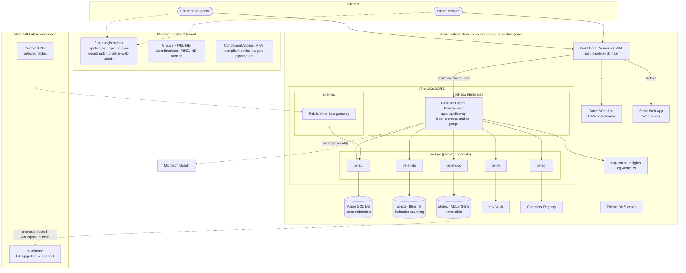

# Azure Design · Pipeline de Posibles Tiendas

Status: Proposed, 10 October 2026. Companion to `TO_BE.md`. Service choices are justified in the ADRs under `ADR/`. Labels: Fact, Assumption, Recommendation, Open, as defined in `TO_BE.md`.

## 1. Service selection summary

| Need | Service | Alternatives considered | Why this one | ADR |
|---|---|---|---|---|
| API compute | Azure Container Apps (workload profile, VNet-integrated) | App Service, AKS, Functions | Container-native, managed identity, scale to zero in non-prod, jobs for background work, VNet integration for private endpoints | ADR-001 |
| Background jobs | Container Apps Jobs (same image) | Functions, Logic Apps, cron in the API | One image, one deployment unit, scheduled and event-triggered | ADR-001 |
| Transactional data | Azure SQL Database, General Purpose, zone-redundant | PostgreSQL Flexible Server, Cosmos DB | RLS with session context, rowversion, ledger tables, Fabric Mirroring | ADR-002 |
| Upload staging | Storage account, Blob, flat namespace | Same account as documents | Defender index tags need a flat namespace; lifecycle cleanup | ADR-003 |
| Definitive documents | Storage account, ADLS Gen2 | OneLake direct, Blob flat | OneLake shortcut, immutability and legal hold, private endpoint | ADR-003 |
| Malware scanning | Microsoft Defender for Storage, on-upload | ClamAV sidecar, third-party | Managed, Event Grid integration, no code | ADR-003 |
| Analytics replica | Fabric Mirroring (selected tables) + OneLake shortcut | Data Factory copy, Synapse Link | Near real time, no pipeline code; Fact: confirmed by the business that capacity and tenant settings exist | ADR-003 |
| Public ingress | Azure Front Door Premium + WAF | Container Apps ingress only, Application Gateway | Single host for SPAs and API, WAF managed rules, private origin via Private Link | Assumption 4 |
| SPA hosting | Azure Static Web Apps (Standard) | Blob static website, Container Apps serving static | Managed CDN-less hosting, preview environments, custom domains; routed behind Front Door | ADR-004 |
| Identity | Microsoft Entra ID, single tenant | None viable | Fact: business decision | ADR-006 |
| Secrets | Azure Key Vault | Container Apps secrets only | Few secrets exist (none for SPAs); Key Vault for certificates and the Graph app config; managed identity removes most secrets | ADR-008 |
| Images | Azure Container Registry (Premium only if private endpoint mandated, else Standard) | GitHub Container Registry | Managed identity pull from Container Apps, vulnerability scanning via Defender | ADR-010 |
| Telemetry | Application Insights (workspace-based) + Log Analytics | Self-hosted OpenTelemetry stack | Native SDKs for FastAPI and browser, alerting, KQL | ADR-010 |
| IaC | Bicep + Azure Verified Modules | Terraform, Pulumi | Azure-native, no state file to protect, GitHub Actions integration | ADR-010 |
| CI/CD | GitHub Actions with OIDC federation to Entra | Azure DevOps | Assumption 5, pending TDD pendiente 12 | ADR-010 |

Not selected: API Management, AKS, Azure Firewall, Service Bus, Redis, Cosmos DB, Application Gateway. Reasons in `TO_BE.md` section 8.

## 2. Deployment topology

Resource naming (Recommendation): `rg-pipeline-{env}`, `ca-pipeline-api-{env}`, `sql-pipeline-{env}`, `st{env}pipelinestg`, `st{env}pipelinedoc`, `kv-pipeline-{env}`, `cr{org}pipeline`, `afd-pipeline`, `swa-pipeline-pwa-{env}`, `swa-pipeline-admin-{env}`.

## 3. Network boundaries

Trust zones, from least to most trusted:

1. **Internet.** Coordinator phones on 4G and admin browsers. Only Front Door is reachable.
2. **Front Door edge.** TLS termination, WAF managed rule set (OWASP) plus bot protection, rate limit rule per client IP as a safety net, header hardening. Origins: two Static Web Apps and the Container Apps ingress through Private Link, so the API is not reachable from the internet directly.
3. **VNet.** Container Apps environment in a delegated subnet with internal ingress only. Private endpoints for SQL, both storage accounts, Key Vault, and ACR, with private DNS zones. Outbound from Container Apps: Entra, Graph, Application Insights, and Defender endpoints over the internet with NSG allow rules; no Azure Firewall (Assumption; no egress-inspection mandate established, revisit per `TO_BE.md` section 8).
4. **Data services.** Public network access disabled on SQL, Key Vault, and both storage accounts. Exception to validate (Open): the documents account needs Fabric trusted workspace access for the shortcut, and the staging account needs Defender for Storage access, both through resource instance rules rather than public access.
5. **Fabric.** The VNet data gateway sits in `snet-gw` and reaches SQL through `pe-sql` for Mirroring (Fact, verified: Mirroring behind a private endpoint requires a VNet or on-premises data gateway).

Simplification option (Recommendation to keep in the ADR): if Seguridad does not mandate private endpoints, the same design works with service firewalls and "trusted Azure services" rules, removing the VNet, the gateway, and Front Door Private Link. Cost drops materially. The decision is ADR-008.

## 4. Identity model

| Principal | Type | Authenticates to | Permissions |
|---|---|---|---|
| Coordinador | Entra user in `PIPELINE-Coordinadores` | `pipeline-pwa-coordinador` SPA, token for `pipeline-api` | App role `Coordinador`; RLS predicate on `oid` |
| Administrador | Entra user in `PIPELINE-Admins` | `pipeline-web-admin` SPA, token for `pipeline-api` | App role `Admin`; RLS bypass by role; Assignment Required on the admin SPA |
| `pipeline-api` backend | User-assigned managed identity | Azure SQL (Entra auth, contained user with least privilege, not `db_owner`), `st-stg` (Blob Data Contributor), `st-doc` (Blob Data Contributor; immutability prevents deletion within retention), Key Vault (Secrets User), ACR (AcrPull), Graph (`User.ReadBasic.All`, `TeamsActivity.Send` application permissions) | No secrets; no storage account keys (shared key access disabled) |
| Container Apps jobs | Same managed identity as the API | Same | Same |
| GitHub Actions | Federated credential on an Entra app (OIDC) | Azure Resource Manager, ACR push | Contributor on `rg-pipeline-{env}` scoped per environment; no long-lived secrets |
| Fabric workspace | Workspace identity | `st-doc` via trusted workspace access (Blob Data Reader) | Read only |
| Fabric VNet data gateway | Gateway connection with an Entra service principal | Azure SQL read for Mirroring | Read only on mirrored tables |
| Defender for Storage | Microsoft first-party | `st-stg` | Scan and tag |

Token validation at the API (ADR-006): issuer `https://login.microsoftonline.com/{tenant}/v2.0` only, audience `pipeline-api` client id, `tid` equal to the tenant, `scp` contains `access_as_user`, `azp` in the set of the two SPA client ids, at least one of the two app roles. The coordinator identity is always `oid` from the token.

Conditional Access (Open with identity team): policy A targets `pipeline-api` for all users: MFA and compliant or app-protected device. Policy B targets `pipeline-api` for `PIPELINE-Admins`: MFA with phishing-resistant method and compliant device. Both are group-scoped rather than client-scoped (Fact, verified).

## 5. Environment strategy

| Environment | Purpose | Differences from production |
|---|---|---|
| `dev` | Developer integration, deployed on merge to `main` | Consumption workload profile, SQL Basic or Serverless, no Front Door (Static Web Apps and Container Apps public ingress with IP restriction), Defender scanning on, no VNet data gateway, Mirroring off, dev Entra registrations with localhost redirect URIs |
| `test` | UAT with coordinators of Xalapa and Azcapotzalco (TDD 14), deployed on tag | Same topology as production, smaller SKUs, test Entra groups, anonymized load file |
| `prod` | Production, deployed on approved release | Full topology from section 2 |

Rules:

- One resource group per environment, one Bicep parameter file per environment, same templates. Drift is detected by a nightly `what-if` run in GitHub Actions that fails on differences.
- Entra app registrations are per environment (`pipeline-api-dev`, etc.) so redirect URIs and groups never mix. They are created by the identity team from the request message in the guide (section 8), with the additions in ADR-006.
- Environment teardown: `dev` can be destroyed and recreated from Bicep; `test` and `prod` have deletion locks and immutable storage, so teardown is a documented manual procedure.
- Local development: docker compose with Azure SQL Edge or a per-developer serverless Azure SQL, Azurite, and the `dev` Entra registrations.

## 6. Cost posture

Qualitative, because SKUs are not final and volumes are small (Assumption).

- Fixed monthly floor is dominated by Front Door Premium, the Container Apps dedicated workload profile needed for VNet integration, Azure SQL General Purpose zone-redundant, the VNet data gateway, and Defender for Storage. Private networking (ADR-008) roughly doubles the floor compared with the service-firewall variant.
- Variable costs are negligible at 87 sites: storage in the tens of GB, Defender scanning per GB uploaded, Log Analytics ingestion kept low by sampling and by excluding request bodies.
- `dev` scales to zero and uses serverless SQL. `test` is paused outside UAT windows.
- Reserved capacity is not recommended until the first year of usage is known.

## 7. Verification checklist for the infrastructure (Phase 0 and 1)

- Fabric shortcut to `st-doc` works with public network access disabled and trusted workspace access enabled (Open 3 in `TO_BE.md`).
- Defender for Storage on-upload scanning writes tags on `st-stg` and the Event Grid subscription reaches the API through Front Door or an internal endpoint.
- Mirroring through the VNet data gateway with table selection, and confirmation that excluded tables never appear in Fabric.
- Front Door Private Link origin to Container Apps internal ingress approved and healthy.
- Container Apps ingress and Front Door origin timeouts are sufficient for a 150 MB download over 4G with `Range` support (Open; numbers not verified in this exercise).
- Edge on Android under Intune app protection: sign-in with redirect in installed PWA and in browser tab, 24-hour offline token renewal, selective wipe clears site data.
