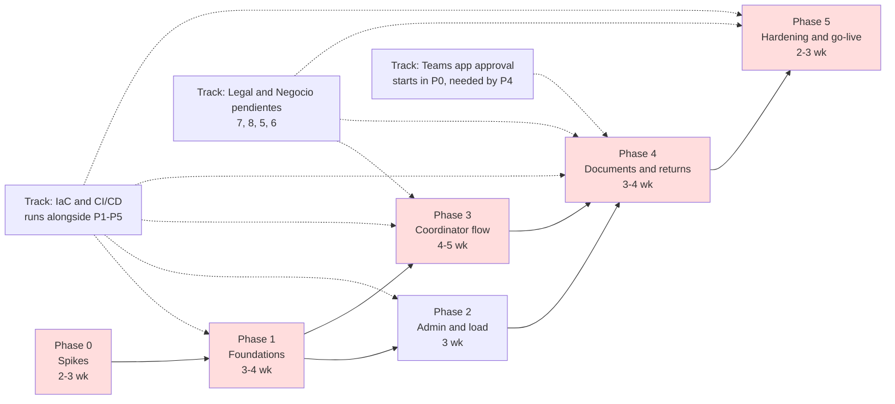

# Implementation Plan · Pipeline de Posibles Tiendas

Status: Proposed, 10 October 2026. Companion to `TO_BE.md` and `AZURE_DESIGN.md`. ADR numbers refer to `ADR/`. Labels: Fact, Assumption, Recommendation, Open, as defined in `TO_BE.md`.

Effort caveat (Fact, TDD section 15): the TDD defers estimates until the team is defined. Every range below is coarse, assumes one backend developer, one frontend developer, and part-time infrastructure and identity support, and must be re-estimated when the team is known.

## 1. Goals

1. Deliver the pipeline described in TDD v0.1 with the accepted proposals from `../Propuesta_mejoras_TDD_v0.1.md`, so that HU-01 through HU-18 pass acceptance with coordinators from Xalapa and Azcapotzalco.
2. Retire the three architecture-changing unknowns before writing production code.
3. Reach production with the quality gates in `PRODUCTION_READINESS.md` section 8 satisfied.

## 2. Principles

- **Foundational risks first.** Spikes before scaffolding; identity, RLS, and CI before features.
- **Incremental.** Each phase ends with a deployable increment in `dev` and, from Phase 2, in `test`.
- **No rewrites.** The TDD design is kept; proposals are folded in where they change a section, not by starting over.
- **Everything versioned.** Code, Bicep, Alembic migrations, pipeline definitions, and these documents live in one repository from Phase 1.
- **No feature claimed done without a test that proves it** in CI or on a real Android device.

## 3. Phase dependencies and parallel tracks

**Critical path** (shaded): Phase 0 spikes → Entra registrations and Azure SQL with RLS (Phase 1) → coordinator offline flow (Phase 3) → documents (Phase 4) → hardening (Phase 5). Phase 2 runs in parallel with Phase 3 once Phase 1 is done.

Total elapsed estimate: 17 to 22 weeks with the team assumed above. Phases 2 and 3 overlap, so elapsed time is shorter than the sum of phase ranges.

## 4. Deployment pipeline

```mermaid
flowchart LR
    PR[Pull request] --> CHK[PR checks<br/>lint, type check, unit tests,<br/>dependency scan, secret scan,<br/>Bicep what-if on dev]
    CHK --> MERGE[Merge to main]
    MERGE --> BUILD[Build API image<br/>and SPA bundles]
    BUILD --> SCAN[Container image scan]
    SCAN --> PUSH[Push to ACR<br/>tag: git sha]
    PUSH --> DDEV[Deploy dev<br/>Bicep + Alembic upgrade<br/>+ new ACA revision]
    DDEV --> IT[Integration tests on dev<br/>incl. RLS cross-access,<br/>offline chain, upload]
    IT --> TAG[Git tag release-x.y.z]
    TAG --> DTEST[Deploy test<br/>same artifacts]
    DTEST --> UAT{UAT approval<br/>GitHub environment gate}
    UAT -->|approved| DPROD[Deploy prod:<br/>1. Alembic upgrade<br/>2. new ACA revision at 0%<br/>3. smoke test<br/>4. shift 100%]
    DPROD --> OK{Smoke and alerts clean?}
    OK -->|no| RB[Rollback: shift traffic to previous revision<br/>Alembic downgrade only if migration is reversible,<br/>otherwise forward fix]
    OK -->|yes| DONE[Release done]
```

Pipeline rules (Recommendation, ADR-010):

- Artifacts are built once and promoted; `test` and `prod` deploy the same image digest and SPA bundle.
- GitHub Actions authenticates to Azure with OIDC federation per environment; no long-lived secrets in the repository.
- Alembic migrations run as a Container Apps job before the new revision receives traffic. Migrations must be backward compatible with the previous revision (expand and contract) so rollback is a traffic shift.
- Nightly `what-if` on all environments fails the workflow on drift.

## 5. Phases

### Phase 0 · Spikes (2 to 3 weeks)

**Objectives.** Produce a written go or no-go for each of the three unknowns that can change the architecture, and publish TDD v0.2 with the results.

**Prerequisites and dependencies.** A dev Azure subscription with permission to create resources; one Intune-managed Android phone with Microsoft Edge; a dev Entra tenant or dev app registrations created by the identity team (request message in the Entra guide section 8, plus ADR-006 additions); Fabric workspace access; Defender for Storage enablement permission.

**Concrete tasks.**

1. **Spike A, identity and offline on device.** Throwaway PWA from the Entra guide Part B with `localStorage` cache. Test: sign-in with `loginRedirect` from the installed PWA and from an Edge tab; app opens and renders IndexedDB data with no network; silent renewal after 24 hours offline then online; selective wipe from Intune and inspect what remains in site storage. Decides ADR-005 and ADR-006 details.
   Go: sign-in works in at least one of installed or tab mode on Edge; cached data renders offline; after wipe no site data remains.
   No-go: no sign-in path works under the Intune policy, or wipe leaves IndexedDB data. Fallback: browser tab only, or escalate the policy to Seguridad.
2. **Spike B, storage path.** Create `st-stg` (flat Blob, Defender on-upload scanning on) and `st-doc` (ADLS Gen2, version-level immutability with a short test retention). Upload a 150 MB PDF through a throwaway FastAPI endpoint in chunks using Put Block and Put Block List; observe the Defender scan tag and Event Grid event; copy to `st-doc`; create a OneLake shortcut from a Lakehouse to `st-doc` with public network access disabled and trusted workspace access on. Decides ADR-003 and part of ADR-008.
   Go: scan tag appears; file is visible in the Lakehouse `Files/pipeline` through the shortcut; immutability blocks deletion; all with managed identity and no account keys.
   No-go: shortcut cannot reach a private account in this tenant (Open 3 in `TO_BE.md`). Fallback: service firewall with resource instance rule, or public access on `st-doc` with Entra-only auth; record in ADR-003.
3. **Spike C, RLS and Mirroring.** Minimal schema (`sitio`, `sitio_contacto`, `auditoria` as ledger). RLS filter and block predicates with `SESSION_CONTEXT`, Admin bypass, SQLAlchemy pool `checkout` and `checkin` hooks. Cross-access test with two coordinator oids and one Admin. Enable Mirroring with table selection excluding `sitio_contacto`; if SQL is behind a private endpoint, deploy a VNet data gateway (Fact: required for Mirroring behind a private endpoint). Decides ADR-002 confirmation and ADR-008.
   Go: cross-access test fails closed at the database with a pooled connection reused across users; excluded tables never appear in Fabric; ledger table rejects `UPDATE` and `DELETE`.
   No-go: Mirroring through the gateway cannot be made to work in the tenant. Fallback: "allow trusted Azure services" on SQL with Seguridad sign-off, or scheduled copy via Data Factory; record in ADR-008.
4. Start the Teams app publication conversation with TI and Seguridad (ADR-007), because approval lead time exceeds one phase.
5. Write TDD v0.2 incorporating the spike outcomes and the accepted proposals.

**Expected deliverables.** Three spike reports with evidence (screenshots, logs, test output); TDD v0.2; updated ADR-003, ADR-005, ADR-006, ADR-008 with status Accepted or Revised.

**Components or files likely to change.** `spikes/` (throwaway, deleted at the end of Phase 1); `architecture/ADR/ADR-003`, `ADR-005`, `ADR-006`, `ADR-008`; the TDD.

**Security and reliability considerations.** Spike resources live in a separate resource group with a deletion date. No production data; the sample load file is anonymized before use. Managed identity from the start so the spike proves the real access path.

**Testing and acceptance criteria.** Each spike has its go or no-go criteria above written before the spike starts and signed by the architect. A spike without evidence is not done.

**Definition of done.** Three signed spike reports; TDD v0.2 circulated; spike resource group scheduled for deletion.

**Risks and mitigation.** Device or tenant access delays (mitigation: request access on day one, run Spike B and C in parallel with the wait); identity team cannot create registrations in time (mitigation: use a dev tenant for Spike A only, and note that Conditional Access behavior must be retested in Phase 1).

**Estimated effort and cost.** 2 to 3 weeks elapsed, one engineer per spike in parallel. Cost: small, dominated by Defender scanning and the VNet data gateway for Spike C; delete after.

### Phase 1 · Foundations (3 to 4 weeks)

**Objectives.** A repeatable platform: repository, infrastructure as code for `dev` and `test`, identity wired end to end, database schema with RLS and ledger, CI/CD with quality gates, and the first two user stories (HU-01 sign-in, HU-02 only my sites).

**Prerequisites and dependencies.** Phase 0 go decisions; Entra registrations for `dev` and `test` created by the identity team; GitHub organization and Azure subscription with OIDC federation permitted; CI/CD platform confirmed or Assumption 5 (GitHub Actions and Bicep) accepted.

**Concrete tasks.**

1. `git init`, monorepo scaffold with pnpm workspaces: `apps/pwa-coordinador`, `apps/web-admin`, `packages/api-client`, `packages/auth`, `packages/ui`, `backend/` (FastAPI, modules `identity`, `sitios`, `transiciones`, `cargas`, `archivos`, `notificaciones`, `auditoria`, `jobs/`), `db/migrations` (Alembic), `infra/bicep`, `.github/workflows`, `architecture/`.
2. Bicep modules (Azure Verified Modules where available) for: resource group, VNet and subnets, private DNS zones, Container Apps environment and app, jobs, Azure SQL server and database (Entra-only auth), two storage accounts, Key Vault, ACR, Application Insights and Log Analytics, Static Web Apps, Front Door (test and prod only), VNet data gateway subnet. Parameter files for `dev` and `test`.
3. Send the registration request to the identity team: three registrations per environment, scope, app roles, groups, Assignment Required on `pipeline-api` and `pipeline-web-admin`, `requestedAccessTokenVersion = 2`, Graph application permissions `User.ReadBasic.All` and `TeamsActivity.Send` for the backend managed identity, Conditional Access policies A and B per `AZURE_DESIGN.md` section 4.
4. GitHub Actions workflows: PR checks (ruff, mypy, eslint, tsc, pytest unit, vitest, dependency audit for pip and npm, secret scan, Bicep lint and `what-if` on `dev`); main build (image, SPA bundles, image scan, push to ACR by digest); deploy `dev`; integration tests on `dev`; nightly drift check.
5. Database: Alembic baseline with the TDD section 6 schema plus `TO_BE.md` section 5 additions; RLS security policy with filter and block predicates on `sitio` and child tables; Admin bypass; `auditoria` and `sitio_estatus_historial` as append-only ledger tables; application contained user with least privilege (no `db_owner`, no `ALTER` on the security policy, `INSERT` and `SELECT` only on ledger tables).
6. Backend `identity` module: JWT validation per ADR-006 (v2 issuer, audience, `tid`, `scp`, `azp` allowlist, roles), `SESSION_CONTEXT` on pool checkout and clear on checkin, Problem Details error handler, correlation id middleware, Application Insights with OpenTelemetry.
7. Backend `sitios` module: `GET /api/v1/sitios` paged, `GET /api/v1/sitios/{id}`, `GET /api/v1/sitios?desde=` delta including removed assignments, `GET /api/v1/me`.
8. `packages/auth`: MSAL config with `localStorage`, token hook that checks `InteractionStatus.None`, redirect handling excluded from the service worker navigation fallback. `packages/api-client`: typed client with `Idempotency-Key`, `If-Match`, and correlation header.
9. PWA and admin shells: sign-in, "Hola, nombre", list of my sites (PWA) and list of all sites (admin). Static Web Apps deployment.
10. Local development: docker compose with Azure SQL Edge or per-developer serverless Azure SQL, Azurite for both accounts, `.env.example`, README with onboarding steps.
11. Integration test suite on `dev`: RLS cross-access at API and at database (two coordinator oids, one Admin, pooled connections), role escalation attempts, token negative cases from the Entra guide C5.

**Expected deliverables.** Repository with CI green; `dev` and `test` environments deployed from Bicep; HU-01 and HU-02 demonstrable on an Intune-managed phone; integration tests running in CI; onboarding README.

**Components or files likely to change.** Everything above is created in this phase. Key paths: `infra/bicep/**`, `.github/workflows/**`, `db/migrations/0001_baseline.py`, `backend/identity/**`, `backend/sitios/**`, `packages/auth/**`, `packages/api-client/**`, `apps/*/src/main.tsx`, `docker-compose.yml`.

**Security and reliability considerations.** No secrets in the repository or in the SPAs; managed identity everywhere; shared key access disabled on storage accounts; Entra-only authentication on SQL; branch protection with required checks; OIDC federation scoped per environment resource group; RLS tested with pooled connections, not fresh ones, because the pool is where context leaks.

**Testing and acceptance criteria.** PR checks under 10 minutes; RLS cross-access suite passes at API and database; token negative cases pass; `what-if` on `dev` reports no drift after deployment; HU-01 and HU-02 acceptance criteria from the TDD pass on a real device; a new developer reaches a running local stack from the README in under half a day.

**Definition of done.** All acceptance criteria met; ADR-001, ADR-002, ADR-006, ADR-009, ADR-010 status Accepted; spike resources deleted.

**Risks and mitigation.** Identity team lead time (mitigation: request sent in Phase 0, dev tenant fallback); Entra ID P1 licence not available for group role assignment (mitigation: direct user assignment, documented owner, Fact: the Entra guide flags the licence need); Container Apps VNet integration and Private Link origin from Front Door more complex than expected (mitigation: Front Door only in `test` and `prod`, `dev` uses direct ingress with IP restriction).

**Estimated effort and cost.** 3 to 4 weeks, two engineers plus infrastructure support. Cost: `dev` and `test` running; `test` paused outside use. The private networking variant (ADR-008) roughly doubles the fixed floor compared with service firewalls (Assumption; no prices asserted).

### Phase 2 · Admin and load (3 weeks, parallel with Phase 3)

**Objectives.** The administrator can populate and govern the pipeline: bulk load with preview and approval, equivalence table with Graph resolution, audit log viewer.

**Prerequisites and dependencies.** Phase 1 done; Graph `User.ReadBasic.All` granted to the backend managed identity; the 10-user equivalence table from Negocio (TDD pendiente 1) or a test version.

**Concrete tasks.**

1. Backend `cargas`: upload endpoint with size and row limits (Open: pendiente 9; propose provisional limits as configuration), hash, parse CSV with pandas and Excel with openpyxl preserving cell types, `.xls` with xlrd, reject `.xlsm`; staging rows with result ok, advertencia, error and reasons per TDD 8.3; decisions endpoint; confirm in one transaction; upsert by `origen_id` that never changes status or captured data; changed `USUARIO`, `REGIÓN`, or `SITIO` on an advanced site becomes advertencia requiring decision; initial status Sitio Prospectado; audit rows.
2. Backend `identity` or a new `equivalencias` service: `PUT /api/v1/admin/equivalencias` resolves email to oid through Graph at save time, revalidates on each load, stores oid, audits changes.
3. Backend `auditoria`: `GET /api/v1/admin/auditoria` with filters by user, site, action, date; export with formula-injection neutralization.
4. Backend `sitios`: reassignment endpoint for Admin with audit and history row.
5. `apps/web-admin`: load wizard (upload, preview grid with per-row result and reasons, decisions, confirm, result summary), equivalences screen, audit viewer, site list with filters.
6. Test fixtures: the 87-row sample file anonymized, files with each error class, `.xls` and `.xlsx` variants, the five suspicious names, near-duplicate coordinates.

**Expected deliverables.** HU-03, HU-04, HU-05, HU-15 demonstrable in `test`; load fixtures in the repository; admin web deployed.

**Components or files likely to change.** `backend/cargas/**`, `backend/auditoria/**`, `backend/sitios/reasignacion.py`, `backend/identity/graph.py`, `db/migrations/0002_cargas.py`, `apps/web-admin/src/**`, `packages/api-client/src/admin.ts`, `tests/fixtures/cargas/**`.

**Security and reliability considerations.** Parse in a background task with a timeout, not in the request thread; never execute Excel macros; validate file type by signature; neutralize formulas on any export; Graph calls with retry and a circuit breaker; equivalence changes audited; Admin-only routes enforced by role dependency and covered by escalation tests.

**Testing and acceptance criteria.** Unit tests for every validation rule in TDD 8.3; the sample file loads with the expected counts (87 rows, 5 advertencias by name, duplicate coordinates flagged as configured); reload of the same file changes nothing; reload with a changed `USUARIO` on an advanced site produces an advertencia and no automatic reassignment; audit viewer shows loads, decisions, and equivalence changes; an email without an Entra account is rejected at save.

**Definition of done.** Acceptance criteria met in `test`; admin UAT session with one administrator completed and findings triaged.

**Risks and mitigation.** Graph permission approval delay (mitigation: manual oid entry behind a feature flag until granted); pandas date handling from Excel (mitigation: openpyxl cell types, explicit tests on the sample's date range); unclear reload semantics (Open: pendiente 3; mitigation: implement upsert as proposed and confirm with Negocio before Phase 5).

**Estimated effort and cost.** 3 weeks, one backend and one frontend engineer. No new Azure cost.

### Phase 3 · Coordinator flow (4 to 5 weeks)

**Objectives.** Field work without signal: list and detail with delta sync, contact capture, measurements, photos, status advance with precondition and idempotency, per-site FIFO queue, in-app return notice.

**Prerequisites and dependencies.** Phase 1 done; minimum contact and measurement fields from Negocio (Open: pendiente 5; provisional: nombre and teléfono for contact, frente, fondo, área for measurements); photo format and cap (Open: pendiente 6; provisional: JPEG, 1.5 MB after compression, 10 per site); Spike A outcome applied.

**Concrete tasks.**

1. Backend `transiciones`: one function per transition with rules in code and parameters from catalogs (`estatus`, `catalogo_tipo_documento`, contact minimum fields); `POST /api/v1/sitios/{id}/transiciones` with `If-Match`, history row, audit row, Problem Details on 412 and 422 including the current state.
2. Backend `sitios`: `PUT /contacto`, `PUT /visita` (last write wins), photo upload through the same upload session mechanism as documents but with small single-part sessions; `operacion_idempotente` table and `Idempotency-Key` middleware storing response code and body, purged after 7 days.
3. Backend `notificaciones`: `notificacion_outbox` table and the in-app notice feed (`GET /api/v1/me/avisos`), delivery job stub that marks in-app delivery; Teams delivery arrives in Phase 4.
4. `apps/pwa-coordinador`: Dexie schema (sites, queue, photos), per-site FIFO queue with ETag threading and chain blocking on 412 or 422, foreground sync on open, `online` event, and timer, pending and error indicators per site, conflict screen showing what changed, capture screens for contact, measurements, photos with client-side compression, status advance with requirement checklist, "devuelto por calidad" banner with the admin comment, cache cleanup on sign-out and on assignment removal.
5. Workbox service worker: app shell precache, runtime cache for static assets only, navigation fallback excluding Entra redirect paths, no caching of `/api/*`.
6. Playwright tests with network emulation: capture contact then advance offline, sync, verify order and ETag threading; admin return in the middle of a chain produces a blocked chain and a visible conflict; duplicate replay produces one record; session expiry with a pending queue resumes after sign-in.

**Expected deliverables.** HU-06, HU-07, HU-08, HU-10 demonstrable on an Intune-managed phone in `test` with real low signal; Playwright offline suite in CI.

**Components or files likely to change.** `backend/transiciones/**`, `backend/sitios/**`, `backend/notificaciones/outbox.py`, `backend/identity/idempotency.py`, `db/migrations/0003_offline.py`, `apps/pwa-coordinador/src/**`, `apps/pwa-coordinador/sw.ts`, `packages/api-client/src/sync.ts`, `tests/e2e/offline/**`.

**Security and reliability considerations.** Only assigned sites stored locally; minimum fields offline; photos deleted from the device after server confirmation; no PDFs offline (Assumption 2); the service worker never holds tokens; sync is idempotent and resumable; conflicts never silently overwrite server state; privacy notice text from Legal shown before contact capture (Open: pendiente 13; placeholder until delivered).

**Testing and acceptance criteria.** Playwright offline suite passes in CI; on-device test in a low-signal area completes a full chain for three sites with zero duplicates and zero lost captures; list of 87 sites loads in under 3 seconds on 4G measured on the device (RNF-08); reassignment removes the site from the previous coordinator's device on next sync; cross-access test extended to child tables passes.

**Definition of done.** Acceptance criteria met; UAT with at least two coordinators (one per region) completed and findings triaged; ADR-005 status Accepted.

**Risks and mitigation.** `loginRedirect` in installed PWA fails under Intune (mitigation: Spike A result, browser-tab mode); IndexedDB quota on low-end phones (mitigation: photo cap, no PDFs offline, quota check with user-facing warning); Negocio field definitions late (mitigation: parameters in catalogs, provisional values, change without migration).

**Estimated effort and cost.** 4 to 5 weeks, one frontend engineer full time, one backend engineer half time. Cost: device telemetry adds Application Insights ingestion; sampling configured.

### Phase 4 · Documents and returns (3 to 4 weeks)

**Objectives.** Complete the pipeline to Recepción de documentos: resumable PDF upload with scan and promotion, immutability, admin return with reason, Teams notification, Fabric visibility.

**Prerequisites and dependencies.** Phases 2 and 3 done; Spike B outcome applied; document catalog (Open: pendiente 4; provisional: four configurable types); return reason catalog (Open: pendiente 8); Teams app approved or Power Automate fallback chosen (ADR-007); `TeamsActivity.Send` granted if the Graph path is chosen.

**Concrete tasks.**

1. Backend `archivos`: `POST /subidas`, `PUT /subidas/{id}/partes/{n}` writing Put Block to `st-stg`, `GET /subidas/{id}` listing received blocks, `POST /subidas/{id}/completar` with Put Block List, sha256, signature, encryption, and page-count checks; `subida_sesion` state machine; Event Grid webhook for Defender scan results; promotion job copying to `st-doc`, inserting `sitio_archivo`, marking previous version no vigente, auditing, deleting staging; `GET /archivos/{id}` streamed download with `Range` and audit.
2. Immutability: Bicep for the five-year time-based retention policy on `st-doc` and the legal hold procedure; `purga_utc` computed from the start event (Open: pendiente 7; provisional: upload date).
3. Backend `transiciones`: Primera visita → Recepción de documentos rule checks all required types have a vigente file; `POST /admin/sitios/{id}/devolver` with `If-Match`, reason code, comment, history, audit, outbox row.
4. Backend `notificaciones`: Teams delivery through Graph activity feed (or Power Automate HTTP trigger per ADR-007), exponential backoff with jitter, circuit breaker, dead-letter state after N attempts with alert; message content without personal data; link to the PWA.
5. `apps/pwa-coordinador`: document screen with required-type checklist, resumable upload with progress and "requires connection" state, retry from last received block, replaced-version handling.
6. `apps/web-admin`: return dialog with reason catalog and comment, document viewer with audited download, site history timeline.
7. Fabric: OneLake shortcut from the Lakehouse to `st-doc` (Bicep or documented manual step), Mirroring with table selection, verification that `sitio_contacto` is absent.
8. Jobs: promotion and outbox as Container Apps jobs (event-triggered and scheduled), purge job skeleton with dry-run mode.

**Expected deliverables.** HU-09, HU-11, HU-12, HU-13, HU-14, HU-16 demonstrable in `test`; files visible in the Lakehouse through the shortcut; Teams notification received by a test coordinator.

**Components or files likely to change.** `backend/archivos/**`, `backend/notificaciones/**`, `backend/transiciones/documentos.py`, `backend/jobs/promote.py`, `backend/jobs/outbox.py`, `backend/jobs/purge.py`, `db/migrations/0004_archivos.py`, `infra/bicep/storage.bicep`, `infra/bicep/jobs.bicep`, `infra/bicep/eventgrid.bicep`, `apps/pwa-coordinador/src/documentos/**`, `apps/web-admin/src/devoluciones/**`, `tests/e2e/upload/**`.

**Security and reliability considerations.** No direct storage URLs to clients; file type by signature; encrypted or corrupt PDFs rejected with a clear message; nothing is promoted without a clean scan result; immutability makes promotion irreversible, so promotion runs only after all checks; downloads audited with user, time, and origin; notification payload excludes contact data; outbox delivery never blocks the return transaction.

**Testing and acceptance criteria.** Upload of a 150 MB PDF over emulated 4G with a forced disconnect resumes from the last received block without re-sending; PDFs over 50 pages, over 150 MB, encrypted, corrupt, or with a non-PDF signature are rejected; a file tagged Malicious by Defender is never promoted and raises an alert; transition to Recepción de documentos fails until all required types are vigente; a return produces a history row, an outbox row, and a Teams notification within the configured retry window; the returned site shows the banner on the coordinator's device; the file appears in the Lakehouse within the shortcut's refresh behavior (verify); deletion of a promoted file is blocked by policy.

**Definition of done.** Acceptance criteria met in `test`; ADR-003 and ADR-007 status Accepted; purge job dry-run report reviewed with Legal.

**Risks and mitigation.** Teams app approval not granted (mitigation: Power Automate fallback, in-app notice remains); Defender scan latency on large files (mitigation: asynchronous promotion with status visible to the coordinator; verify typical latency in Spike B); Event Grid delivery to a private ingress (mitigation: Event Grid to a Container Apps job trigger or a polling fallback on tags; verify in Phase 1 IaC); immutability misconfiguration locking test data (mitigation: short retention in `dev` and `test`, five years only in `prod`).

**Estimated effort and cost.** 3 to 4 weeks, two engineers. Cost: Defender scanning per GB uploaded, storage growth small; Event Grid negligible.

### Phase 5 · Hardening and go-live (2 to 3 weeks)

**Objectives.** Production readiness per `PRODUCTION_READINESS.md`: penetration test, RLS test report, retention purge with legal hold, alerts and dashboards, runbooks, restore drill, production infrastructure, go-live.

**Prerequisites and dependencies.** Phase 4 done; production Entra registrations and groups; production subscription and Front Door custom domain and certificate; Legal pendientes 7 and 13 closed; RPO and RTO ratified (Open: pendiente 12); penetration test vendor scheduled.

**Concrete tasks.**

1. Deploy `prod` from Bicep with the full topology; Front Door Private Link origin approved; WAF in prevention mode after a detection-mode soak in `test`.
2. Penetration test covering API, both SPAs, file upload, and RLS; fix all critical and high findings; retest.
3. RLS and role escalation test report generated from the CI suite and attached to HU-18.
4. Retention purge job: production mode, legal hold procedure, audit rows, dry-run in `prod` before enabling the schedule (HU-17).
5. Observability: dashboards and alerts from `PRODUCTION_READINESS.md` section 2 deployed by Bicep; alert routing to the on-call channel; log sampling and ingestion cap configured.
6. Runbooks written and walked through with the operations owner; incident severity and paging defined.
7. Backup and restore drill: point-in-time restore of Azure SQL to a side database, verify RLS policy and ledger integrity after restore; storage soft-delete recovery test.
8. Resilience checks: SQL failover simulation, Graph outage simulation (outbox retries), Defender delay simulation (promotion waits), Container Apps revision rollback rehearsal.
9. Performance on device: list under 3 seconds on 4G with the full production dataset; upload and download of a 150 MB file through Front Door within the ingress timeouts (verify).
10. Privacy notice from Legal integrated in the PWA before contact capture; Defender for Cloud recommendations on all resources reviewed.
11. Go-live checklist executed; coordinators onboarded with Edge installed and Intune policy applied; hypercare window with daily review for two weeks.

**Expected deliverables.** HU-17 and HU-18 complete; penetration test report with closure evidence; restore drill report; dashboards, alerts, and runbooks live; production deployment; hypercare log.

**Components or files likely to change.** `infra/bicep/prod.bicepparam`, `infra/bicep/monitoring.bicep`, `infra/bicep/frontdoor.bicep`, `backend/jobs/purge.py`, `docs/runbooks/**`, `apps/pwa-coordinador/src/privacidad/**`, `.github/workflows/deploy-prod.yml`.

**Security and reliability considerations.** WAF prevention mode only after false-positive review; penetration test on `test` with production-equivalent topology; no production data in lower environments; break-glass access to production documented and audited; deletion locks on `prod` resource group; purge job cannot run without a signed configuration change.

**Testing and acceptance criteria.** All quality gates in `PRODUCTION_READINESS.md` section 8 checked with evidence; no critical or high penetration findings open; restore drill completed within the ratified RTO; rollback rehearsal completed; on-device performance target met.

**Definition of done.** Production live with coordinators of Xalapa and Azcapotzalco; hypercare completed with no Sev 1 or Sev 2 open; ADRs 001 to 010 all Accepted; this plan closed with a retrospective.

**Risks and mitigation.** Penetration findings requiring design change (mitigation: schedule the test early in the phase, reserve a week); Legal pendientes unresolved (mitigation: purge job stays in dry-run, retention policy configured but legal hold procedure manual; go-live without purge is acceptable because retention is five years); production Front Door and certificate provisioning lead time (mitigation: start in Phase 4).

**Estimated effort and cost.** 2 to 3 weeks, two engineers plus operations and security time; penetration test vendor cost; production environment running from this phase.

## 6. Dependency table

| Task | Depends on |
|---|---|
| Phase 1 Entra wiring | Phase 0 Spike A; identity team registrations |
| Phase 1 RLS schema and pool hooks | Phase 0 Spike C |
| Phase 1 storage Bicep | Phase 0 Spike B |
| Phase 2 equivalences with Graph | Phase 1; Graph `User.ReadBasic.All` granted |
| Phase 2 bulk load | Phase 1 schema; equivalence table from Negocio (pendiente 1) |
| Phase 3 transitions | Phase 1; contact and measurement fields (pendiente 5) |
| Phase 3 offline queue | Phase 1 `packages/auth` and `api-client`; Spike A |
| Phase 3 photos | Photo limits (pendiente 6) |
| Phase 4 upload and promotion | Phase 3 upload sessions; Spike B; Defender enabled; Event Grid |
| Phase 4 document transition | Phase 3 transitions; document catalog (pendiente 4) |
| Phase 4 returns | Phase 2 admin web; Phase 3 history; reason catalog (pendiente 8) |
| Phase 4 Teams delivery | Teams app approval or Power Automate decision (ADR-007), started in Phase 0 |
| Phase 4 Fabric shortcut and Mirroring | Spike B and C; VNet data gateway (ADR-008) |
| Phase 5 purge | Phase 4 immutability; retention start event (pendiente 7) |
| Phase 5 penetration test | Phase 4 complete in `test` |
| Phase 5 go-live | RPO and RTO (pendiente 12); privacy notice (pendiente 13); production registrations |

## 7. Parallel work

| Track A | Track B | Condition |
|---|---|---|
| Spike A (device) | Spikes B and C (Azure) | Different engineers and resources |
| Phase 1 Bicep and CI/CD | Phase 1 backend identity and schema | Bicep targets `dev` first; backend runs locally meanwhile |
| Phase 2 admin web and load | Phase 3 PWA and offline | Both need only Phase 1; one frontend engineer per app or sequence PWA first |
| Phase 4 upload and promotion (backend) | Phase 4 PWA document screen (frontend) | Contract agreed in `packages/api-client` first |
| Teams app approval (TI, Seguridad) | Everything from Phase 0 | Lead time; does not block until Phase 4 |
| Legal pendientes 7 and 13 | Everything until Phase 5 | Purge and privacy notice are last to integrate |

## 8. What is not in this plan

- The AI inspection agent over Fabric (TDD 2.2). The plan only guarantees files and metadata are visible in the Lakehouse.
- Power BI dashboards.
- A native Android app.
- Roles beyond Coordinador and Admin.
- Multi-region disaster recovery; zone redundancy and geo-redundant backups are the default (Assumption 8 in `TO_BE.md`).
- API Management, AKS, Azure Firewall, Service Bus, caching, and search; see `TO_BE.md` section 8 for the conditions that would bring them in.
