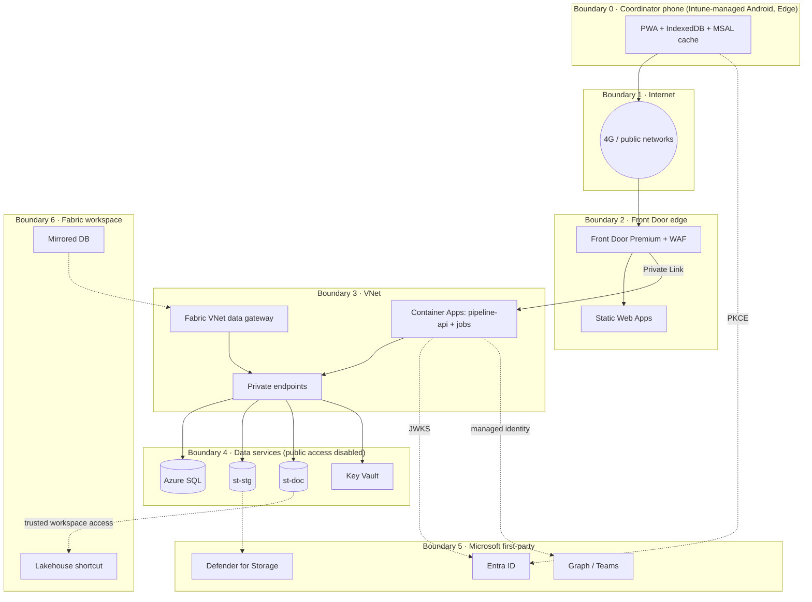

# Security Architecture · Pipeline de Posibles Tiendas

Status: Proposed, 10 October 2026. Companion to `TO_BE.md` and `AZURE_DESIGN.md`. Labels: Fact, Assumption, Recommendation, Open, as defined in `TO_BE.md`. ADR numbers follow the mapping in `AZURE_DESIGN.md` section 1.

## 1. Scope and assets

| Asset | Classification | Where it lives | Why it matters |
|---|---|---|---|
| Site records (`sitio`, `sitio_visita`, status history) | Internal, confidential to Tiendas 3B | Azure SQL, PWA IndexedDB (assigned sites only), Fabric mirror | Commercial expansion intent; competitive value |
| Owner contact data (`sitio_contacto`) | Personal data (datos personales) | Azure SQL only; excluded from Fabric Mirroring (Recommendation); minimal copy in IndexedDB | Fact: Legal approved its processing (TDD 5.3). Regulated under LFPDPPP (section 6) |
| Documents and photos (PDF hipotecas, uso de suelo, fotos del inmueble) | Confidential; may contain third-party personal data | `st-doc` (ADLS Gen2, immutable), transiently `st-stg`, photos transiently on the phone | Legal evidence; 5-year retention (TDD RF-11) |
| Audit log and status history (`auditoria`, `sitio_estatus_historial`) | Integrity-critical | Azure SQL ledger tables (ADR-009) | Non-repudiation of returns, loads, downloads |
| Bulk load files (`carga_lote`, `carga_fila_staging`) | Internal | Azure SQL, transiently in API memory | Source of truth for reconciliation |
| Equivalence table (`coordinador_equivalencia`) | Internal, contains corporate emails and oids | Azure SQL | Drives assignment and therefore isolation |
| Credentials and tokens | Secret | Entra-issued JWTs in Edge localStorage (Assumption 7); managed identities; OIDC federation for CI | Compromise equals impersonation |
| Infrastructure definitions and pipelines | Internal | Git repository (to be created), GitHub Actions | Supply chain entry point |

Assets explicitly absent by design: storage account keys (shared key access disabled), client secrets in SPAs (public clients), database passwords (Entra authentication only).

## 2. Trust boundaries

Boundary crossings and the control that guards each:

| Crossing | Control |
|---|---|
| 0 → 1 | Intune app protection on Edge (PIN, encryption, no copy-paste out, selective wipe); TLS 1.2+ |
| 1 → 2 | Front Door TLS termination, WAF managed rules, rate limit safety net; only Front Door is public |
| 2 → 3 | Private Link origin; Container Apps ingress internal only; Front Door identifier header checked by the API (Recommendation) |
| 3 → 4 | Private endpoints, private DNS, public network access disabled, managed identity, least-privilege RBAC and SQL roles |
| 0/3 → 5 | PKCE for public clients; JWT validation at the API; managed identity for Graph with application permissions scoped to the minimum |
| 4 → 6 | Mirroring with table selection through the gateway's service principal (read only); shortcut with workspace identity (Blob Data Reader); Fabric workspace roles restrict who sees the replica (Open) |

## 3. Threat model (STRIDE per boundary)

| Boundary | Threat (STRIDE) | Affected asset | Control | Residual |
|---|---|---|---|---|
| 0 phone | Information disclosure: lost or stolen phone with cached sites and contacts | Site records, owner contact data | Intune app protection on Edge, device PIN, selective wipe, minimum fields cached, photos deleted after confirmed upload, no PDFs offline (Assumption 2) | Data between last sync and wipe is exposed if the PIN is broken. Low. |
| 0 phone | Spoofing: another person uses the coordinator's unlocked session | Site records | App protection PIN with timeout; short-lived access tokens; sign-out policy for shared devices (Open 6) | Medium until shared-phone question is answered |
| 0 phone | Tampering: modified PWA or queue in IndexedDB | Integrity of captures | All business rules re-validated server-side; `If-Match`; RLS; the client is untrusted by design | Low |
| 1 internet | Information disclosure: interception | Tokens, data in transit | TLS everywhere; HSTS; no plaintext origins | Low |
| 2 edge | Denial of service: volumetric or application-layer flood | Availability | Front Door DDoS protection, WAF, rate limit rule, Container Apps scale limits | Low; ten users means abuse is easy to spot |
| 2 edge | Tampering: request smuggling, injection via headers | API | WAF managed rules; Pydantic validation; no header-derived identity | Low |
| 2 → 3 | Spoofing: direct calls to the Container Apps origin bypassing WAF | API | Internal ingress plus Private Link; API rejects requests missing the Front Door identifier header (Recommendation) | Low |
| 3 API | Elevation of privilege: coordinator calls admin endpoint | All data | Role check on every admin route; Assignment Required on `pipeline-web-admin`; RLS bypass only when `SESSION_CONTEXT('rol')='Admin'` | Low |
| 3 API | Elevation of privilege: token minted for another resource or by another client | All data | Audience, issuer v2, `tid`, `scp` contains `access_as_user`, `azp` allowlist (ADR-006) | Low |
| 3 API | Information disclosure: cross-coordinator read through a coding error | Site records | Three layers: oid from token only, service filter, RLS filter and block predicates on `sitio` and child tables with denormalized `coordinador_oid` | Low; covered by automated cross-access tests |
| 3 API | Elevation of privilege: compromised backend sets arbitrary `SESSION_CONTEXT` | All data | Fact (TDD 5.2): RLS does not protect against a compromised backend. Mitigations: managed identity, SQL user not `db_owner`, cannot alter policies, Defender for Containers, image scanning, audit and anomaly alerts | Medium. Accepted and documented |
| 3 API | Tampering: malicious upload (polyglot, malformed PDF, zip bomb) | API availability, downstream readers, AI agent | Signature check, `pypdf` structural check, encrypted PDF rejected, page and size limits, Defender for Storage on-upload scan before promotion, Event Grid result consumed by the API | Medium if Defender is unavailable in the tenant (verify); fallback is to hold files in staging |
| 3 API | Tampering: formula injection in CSV/XLSX | Admin workstation via future export | Neutralize cells beginning with `=`, `+`, `-`, `@` on any export and in the preview grid | Low; no export in scope today |
| 3 API | Tampering: path traversal in storage object names | Documents of other sites | Object paths built from server-side ids and sha256 only; original filename stored as metadata, never used in the path | Low |
| 3 API | Repudiation: admin denies a return, coordinator denies a download | Audit | Ledger tables; INSERT-only grants; every write and download audited with oid, time, origin | Low |
| 3 API | Denial of service: large chunked uploads exhausting the API | Availability | Chunk size cap, per-user concurrent session cap, session expiry, staging lifecycle cleanup | Low |
| 3 jobs | Tampering: purge job deletes documents under legal hold | Documents | Immutability policy and legal hold enforced by storage, not by job logic (ADR-003) | Low |
| 4 data | Information disclosure: direct access to storage or SQL | All data | Public access disabled, private endpoints, shared key disabled, Entra-only SQL auth, RBAC on the data plane | Low |
| 4 data | Tampering: audit rows edited by a DBA | Audit | Ledger tables provide tamper evidence through digests (ADR-009) | Low |
| 5 Entra/Graph | Spoofing: Graph application permission abused by a compromised identity | Teams, user directory | Permissions limited to `User.ReadBasic.All` and `TeamsActivity.Send`; no mail or chat read; Entra sign-in logs | Low |
| 6 Fabric | Information disclosure: replica exposes personal data to analysts | Owner contact data | `sitio_contacto` and `auditoria` excluded from Mirroring (Recommendation); Fabric workspace roles (Open) | Medium until Fabric roles are defined |
| Supply chain | Tampering: malicious dependency or image | Everything | Lockfiles, pinned versions, Dependabot, `pip-audit` and `npm audit` gates, container scanning in ACR, OIDC-only deploy identity, protected `main` branch | Medium; residual risk inherent in third-party code |

SSRF is not applicable: the API never fetches user-supplied URLs. CORS is eliminated in production by serving SPAs and API under one Front Door host (ADR-004); the `localhost` origins in the Entra guide are for development only.

## 4. Controls by area

### 4.1 Authentication and authorization

- Fact: Entra ID, single tenant, corporate accounts only, no guests (TDD 5.1).
- Authorization code flow with PKCE in both SPAs; MSAL handles PKCE (guide section 1).
- Access tokens v2 (`requestedAccessTokenVersion = 2`, guide A5). The API accepts only the v2 issuer in production (Recommendation; the guide's dual-issuer list is for bootstrapping).
- Validation per request: signature via cached JWKS, `iss`, `aud`, `tid`, `exp`, `scp` contains `access_as_user`, `azp` in the two SPA client ids, at least one app role. Coordinator identity is always `oid` from the token; no endpoint accepts it as a parameter (TDD 5.2 layer 1).
- MFA and device requirements through Conditional Access targeting `pipeline-api` (Fact, verified: CA evaluates against the resource). Stricter policy for `PIPELINE-Admins`.
- Assignment Required = Yes on `pipeline-api` and on `pipeline-web-admin` (Recommendation), so a coordinator cannot sign in to the admin app.

### 4.2 Role-based access control

- Two app roles, `Coordinador` and `Admin`, assigned through security groups with direct membership (guide A9). Fact from the guide: group-based role assignment may require Entra ID P1 (verify with identity); fallback is direct user assignment, manageable at ten users.
- Server-side route guards per role. Admin routes under `/api/v1/admin/*`.
- Data-level RBAC through RLS: filter and block predicates `coordinador_oid = SESSION_CONTEXT('oid') OR SESSION_CONTEXT('rol') = 'Admin'` on `sitio`, `sitio_contacto`, `sitio_visita`, `sitio_archivo`. `SESSION_CONTEXT` set on pool checkout, cleared on checkin, never `read_only` (proposal B1).
- The application's SQL user: `db_datareader`, `db_datawriter` on business tables, INSERT-only on ledger tables, EXECUTE on the session-context procedure, no DDL, no ownership of the security policy.

### 4.3 Identity federation and service-to-service authentication

- Backend to Azure SQL, both storage accounts, Key Vault, ACR, Graph: one user-assigned managed identity (`AZURE_DESIGN.md` section 4). No connection strings with passwords, no storage keys.
- Graph application permissions: `User.ReadBasic.All` (resolve email to oid at equivalence save) and `TeamsActivity.Send` (ADR-007). Admin consent granted by the identity team; added to the request message in the guide section 8 (Recommendation).
- GitHub Actions to Azure: workload identity federation (OIDC), one federated credential per environment, Contributor scoped to the environment resource group. No stored service principal secrets.
- Fabric to storage: workspace identity with Blob Data Reader via trusted workspace access (Open: tenant capability to verify).
- Fabric Mirroring to SQL: gateway connection with a service principal holding read on mirrored tables only (Fact, verified: gateway required behind a private endpoint).

### 4.4 Secrets, certificates and keys

- Inventory of secrets after managed identity: effectively none for runtime. Key Vault holds the Front Door custom-domain certificate (if not Front Door-managed), the Event Grid webhook validation secret if used, and any future third-party key. Container Apps reads them as Key Vault references through the managed identity.
- SPAs hold no secrets. Client ids and tenant id are public values (guide section 3.3).
- Key Vault: RBAC permission model, soft delete and purge protection on, public access disabled, private endpoint, diagnostic logs to Log Analytics.
- Encryption keys: Microsoft-managed keys for SQL, storage and Key Vault (Assumption). Customer-managed keys are not required by any stated requirement; revisit if Seguridad mandates them.

### 4.5 Encryption in transit and at rest

- TLS 1.2 minimum at Front Door, Static Web Apps, Container Apps ingress, SQL (`Encrypt=yes`, `TrustServerCertificate=no`), storage (HTTPS only), Key Vault.
- At rest: Transparent Data Encryption on Azure SQL, storage service encryption, Key Vault HSM-backed keys. Fact: TDD 5.3 requires encryption in transit and at rest.
- Device: Intune app protection requires encryption of organizational data in Edge (Fact, verified from Intune documentation levels).

### 4.6 Network boundaries, ingress and egress

- Ingress: only Front Door is public. WAF in prevention mode with the managed rule set and bot rules. Static Web Apps restricted to Front Door via the Front Door id header. Container Apps internal ingress reached through Private Link.
- Private endpoints and private DNS for SQL, `st-stg`, `st-doc`, Key Vault, ACR (ADR-008). Public network access disabled on all four, with resource instance exceptions for Defender for Storage and Fabric trusted workspace access (Open).
- Egress from Container Apps: NSG allows Entra, Graph, Application Insights, Defender and Microsoft Container Registry endpoints; no Azure Firewall (Assumption; no egress-inspection mandate established).
- Dev environment (no Front Door): Container Apps public ingress with IP restrictions and Static Web Apps with Entra sign-in only.

### 4.7 Input validation and application attacks

- All request bodies validated with Pydantic; unknown fields rejected; sizes bounded.
- Files: real type by signature (magic bytes), not extension. PDF: parse with `pypdf`, reject encrypted or corrupt, enforce 50 pages and 150 MB (Fact, TDD RNF-05). Images: re-encode on the client; verify signature on the server. `.xlsm` rejected (Fact, TDD 8.1).
- Bulk load: first sheet only; every column read as text or with explicit cell types; explicit conversions; coordinates range-checked; dates restricted to the documented formats; formula-leading cells neutralized on export and preview.
- Storage paths: built from server-generated ids and sha256; original filename only in metadata; no user-controlled path segments.
- SSRF: not applicable, the API makes no user-directed outbound requests.
- CORS: not needed in production (single host); development allows only the two localhost origins.
- CSP for both SPAs: `default-src 'self'`; `connect-src 'self' https://login.microsoftonline.com` plus the Application Insights ingestion endpoint; `frame-ancestors 'none'`; `img-src 'self' blob: data:` for photo previews. Report-only first, enforce in Phase 5.
- Security headers at Front Door: HSTS, `X-Content-Type-Options`, `Referrer-Policy`, `Permissions-Policy` limiting camera to self.
- Rate limiting: Front Door rate limit rule per client IP as a safety net; per-user limits at the API only if abuse appears (`TO_BE.md` section 8).

### 4.8 Dependency and container vulnerability management

- Lockfiles committed (`pnpm-lock.yaml`, `uv.lock` or `requirements.txt` with hashes). Dependabot for npm, pip and GitHub Actions.
- CI gates: `npm audit` and `pip-audit` fail on high or critical; Trivy or Defender scan on the image before push; ACR with Defender for Containers continuous scanning.
- Base image: official Python slim, pinned by digest, rebuilt weekly by a scheduled workflow.
- SBOM generated per image (CycloneDX) and stored as a build artifact.

### 4.9 Audit trails and security monitoring

- Application audit: every write and every document download inserts into `auditoria` with oid, UTC time, action, entity, ip, origin (Fact, TDD RNF-07). Ledger tables and INSERT-only grants (ADR-009).
- Platform audit: Entra sign-in and audit logs, Azure Activity Log, SQL auditing to Log Analytics, Key Vault and storage diagnostic logs, Front Door WAF logs.
- Detection: Defender for Cloud plans for SQL, Storage, Containers and Key Vault. Alerts for repeated 401/403 from one oid, admin actions outside business hours, RLS policy changes, mass downloads, WAF blocks spikes, failed managed identity calls.
- Logs contain no owner contact data and no file contents (Fact, TDD 5.3). Request bodies are never logged.

### 4.10 Data privacy and sensitive information handling

- Fact: Legal approved the processing of owner contact data (TDD 5.3). Open: privacy notice text (TDD pendiente 13) must be shown in the PWA before the first contact capture.
- Data minimization: the phone caches only assigned sites and the minimum fields; photos and PDFs leave the device once confirmed; cache cleared on sign-out, session expiry or selective wipe.
- `sitio_contacto`, `auditoria`, `operacion_idempotente` and `carga_fila_staging` excluded from Fabric Mirroring (Recommendation). Teams notifications never include contact data (Fact, TDD 11).
- Owner data of discarded sites before five years: Open with Legal (TDD pendiente 7).
- Application Insights: IP masking on, no custom dimensions with personal data, sampling on.

### 4.11 Backup protection and recovery access

- Azure SQL automated backups with zone-redundant storage and long-term retention; restore tested in Phase 5 (`PRODUCTION_READINESS.md`).
- Storage: geo-redundant, soft delete for blobs and containers, versioning on `st-doc`; immutable documents cannot be deleted during retention even by owners (ADR-003).
- Resource locks (`CanNotDelete`) on `test` and `prod` resource groups, SQL server, both storage accounts and Key Vault.
- Recovery access: restore operations require an Entra PIM-eligible role on the subscription (Recommendation); no standing Owner assignments.

### 4.12 Supply chain security and software provenance

- Protected `main` with required reviews and required status checks; signed commits recommended.
- GitHub Actions pinned to commit SHAs; OIDC federation only; environment protection rules with approvers for `test` and `prod`.
- Images built once, tagged with git SHA, promoted by digest across environments; no rebuild per environment.
- Optional: cosign signing of images and verification at deploy (Recommendation for Phase 5 if Seguridad asks for it).
- Bicep templates reviewed like code; `what-if` drift job nightly.

## 5. Mobile device security

- Fact: Android managed with Intune (TDD 17.1). Fact, verified: Microsoft Edge for Android is the browser Intune manages with app protection policies (PIN, encryption, cut-copy-paste restrictions, selective wipe) and can be made the required browser for links from managed apps.
- Assumption 6: Edge is the mandated PWA host. Assumption 7: MSAL cache in `localStorage`, required so the app can open offline; justified by Edge app protection and the data minimization above. Seguridad must ratify (section 7).
- The PWA opens cached data without a valid token; a token is needed only to sync (`TO_BE.md` section 6.1). After the SPA refresh token lifetime (the guide states 24 hours; verify in tenant policy), silent renewal fails and the user must sign in interactively when online; the queue is preserved.
- Selective wipe through Intune removes Edge's organizational data; verify that site storage (IndexedDB, localStorage) is included (Open, Phase 0 spike).
- Shared phones (Open 6): if confirmed, enforce sign-out on close and per-user cache namespaces.
- Known issue to test in Phase 0: `loginRedirect` from an installed PWA may land in a browser tab instead of the installed window (verify on device). Fallback is running the PWA inside Edge without installing.

## 6. Regulatory and compliance

- Owner contact data is datos personales under Mexico's Ley Federal de Protección de Datos Personales en Posesión de los Particulares (LFPDPPP). Consequences for this design: privacy notice (aviso de privacidad) in the PWA, purpose limitation (contact for site negotiation only), retention and deletion rules for discarded sites, access limited to the assigned coordinator and administrators, and a documented data flow to Fabric. Confirm obligations and the notice text with Legal (TDD pendiente 13).
- No other framework is assumed. ISO 27001, SOC 2 or sector rules apply only if Tiendas 3B has adopted them; confirm with Seguridad and Legal before adding controls or evidence requirements.
- Microsoft's platform certifications cover the Azure services used; they do not cover the application. Shared-responsibility boundaries are documented per service in `AZURE_DESIGN.md`.

## 7. Outstanding security risks and pending decisions

| # | Item | Owner | Blocks |
|---|---|---|---|
| S1 | Ratify `localStorage` for MSAL under Intune app protection (Assumption 7) | Seguridad | Phase 1 PWA auth package |
| S2 | Confirm Conditional Access policies: MFA and device requirements for `pipeline-api`, stricter for Admins | Identidad, Seguridad | Phase 1 |
| S3 | Entra ID P1 availability for group-to-role assignment (verify) | Identidad | Phase 1, fallback is direct assignment |
| S4 | Graph application permissions `User.ReadBasic.All` and `TeamsActivity.Send` with admin consent | Identidad | Phase 2 (oid resolution), Phase 4 (Teams) |
| S5 | Fabric trusted workspace access to `st-doc` with public access disabled (Open 3) | TI, Fabric admin | ADR-003 confirmation, Phase 0 |
| S6 | Defender for Storage on-upload scanning enabled in the subscription (verify availability and cost approval) | Seguridad, TI | Phase 0 |
| S7 | Fabric workspace roles so the mirrored data is visible only to the analytics team and the AI agent | Datos, Seguridad | Phase 4 |
| S8 | Retention start event, legal hold, discarded-site personal data (TDD pendiente 7) | Legal | Immutability policy configuration, Phase 4 |
| S9 | Privacy notice text (TDD pendiente 13) | Legal | Phase 3 contact capture screen |
| S10 | Shared phones between coordinators (Open 6) | Negocio | Sign-out policy, Phase 3 |
| S11 | Accepted residual: a compromised backend can set any `SESSION_CONTEXT` (TDD 5.2) | Seguridad sign-off | Production readiness |
| S12 | Private endpoints mandate or preference (ADR-008) | Seguridad | Phase 1 network topology and cost |
| S13 | Customer-managed keys not planned (Assumption) | Seguridad | None unless mandated |

## 8. Security testing

| Test | Layer | When | Pass criterion |
|---|---|---|---|
| Cross-coordinator access: coordinator A requests, lists, syncs and downloads coordinator B's site and files | API and service | Every CI run | 404 on detail and download; B's rows never in A's list or delta; covers `sitio` and all child tables |
| RLS at the database: direct queries with `SESSION_CONTEXT` for A, B and Admin, plus queries with no context | Database integration | Every CI run against a real test database | A sees only A; Admin sees all; no context sees nothing; UPDATE and DELETE across owners blocked by the block predicate |
| Role escalation: Coordinador token on every admin route; token without roles; token with `scp` missing; token with wrong `azp`; v1 issuer | API | Every CI run with locally signed test tokens | 403 or 401 as specified in ADR-006 |
| Ledger protection: application user attempts UPDATE and DELETE on `auditoria` and history | Database | Every CI run | Permission denied; ledger digest verification succeeds |
| Malicious files: polyglot PDF, encrypted PDF, 51-page PDF, oversized file, renamed executable, EICAR test file through staging | API and Defender | CI for parser checks; Phase 0 and Phase 4 for Defender | Rejected with a clear error; EICAR never promoted to `st-doc` |
| Formula injection: load file with cells starting `=`, `+`, `-`, `@` | API | Every CI run | Neutralized in preview and any export |
| Offline chain with tampered queue: altered ETag, replayed key with different body | API | Every CI run | 412 on stale ETag; replay with different body rejected |
| Dependency and image scanning | CI | Every build | No high or critical findings, or a documented exception with expiry |
| Defender for Cloud recommendations | Platform | Phase 5 gate and monthly | No high-severity recommendations open on production resources |
| Penetration test by an independent team, including the PWA on a managed Android | All | Before production (Fact, TDD HU-18) | No critical or high findings open; report attached to production readiness |
| Backup restore and legal hold drill | Platform | Phase 5 | Point-in-time restore completes; immutable blob deletion attempt fails |
