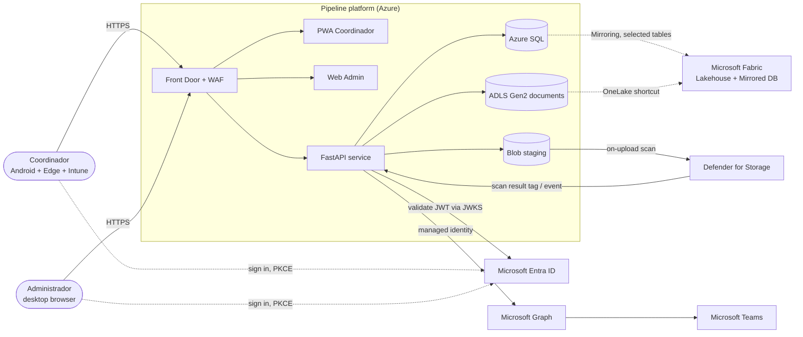
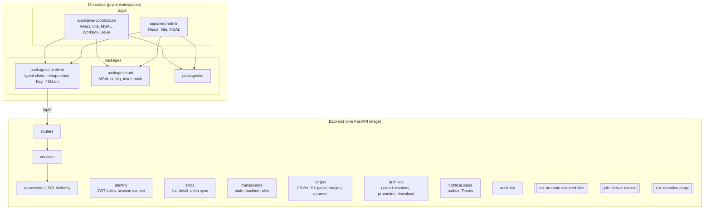
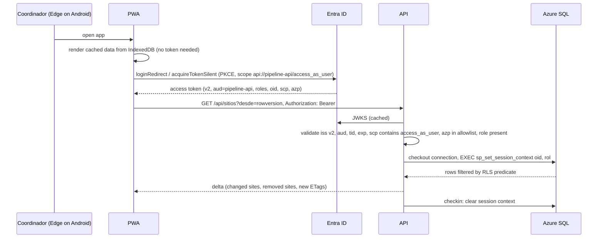
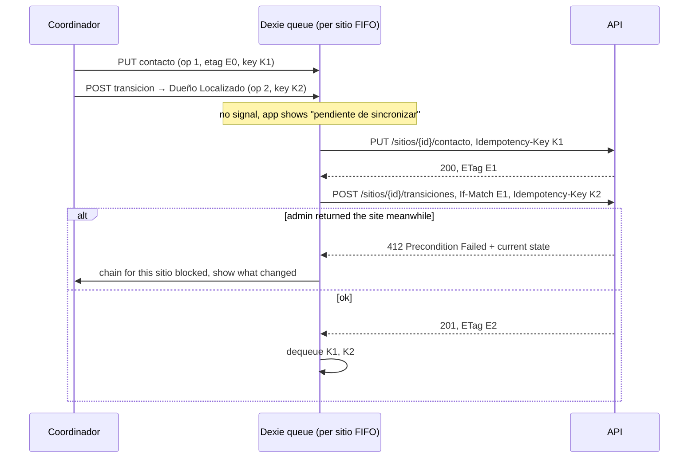
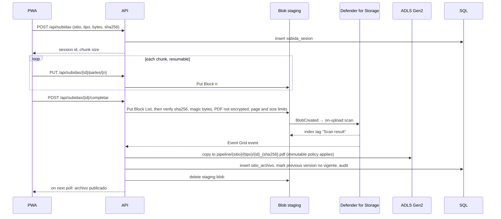

# Target Architecture (TO-BE) · Pipeline de Posibles Tiendas

Status: Proposed, 10 October 2026. Derived from TDD v0.1 plus the accepted proposals in `../Propuesta_mejoras_TDD_v0.1.md`. This is an incremental evolution of the TDD, not a redesign.

Labels used throughout the architecture set:

- **Fact**: stated in the TDD or the Entra guide, or verified in Microsoft Learn during this exercise.
- **Assumption**: a default adopted on 10 October 2026 so planning can proceed. Listed in section 9.
- **Recommendation**: a change this architecture proposes over TDD v0.1.
- **Open**: a question that still needs an owner's answer. Listed in section 10 and in the TDD's pendientes.

## 1. Purpose and scope

Ten regional coordinators (Xalapa and Azcapotzalco today) manage candidate store sites from Intune-managed Android phones, often without signal. Sites move through four statuses: Sitio Prospectado, Dueño Localizado, Primera visita, Recepción de documentos. An administrator loads sites from CSV or Excel, approves doubtful rows, can return a site to an earlier status with a reason, and manages the user-to-email equivalence table. Documents must land in Microsoft Fabric with a five-year retention, ready for a later AI agent. Each coordinator sees only their own sites, enforced at API, service, and database layers.

Out of scope for this version (TDD 2.2): the AI inspection agent, Power BI dashboards, a native Android app, and roles beyond Coordinador and Admin.

## 2. Architectural style

**Modular monolith with two first-party clients.** One FastAPI service, one Azure SQL database, one container image. Asynchronous work is limited to three jobs (file promotion after malware scan, notification outbox delivery, retention purge) and runs from the same image as Container Apps jobs. No microservices, no message broker, no Kubernetes. Rationale: ten users, 87 sites, one team, and no integration beyond Entra, Graph, and Fabric. See ADR-001 and the "considered and rejected" list in section 8.

## 3. System context

External dependencies and what breaks without them:

| Dependency | Used for | If unavailable |
|---|---|---|
| Entra ID | Sign-in, tokens, JWKS | New sign-ins fail. Cached JWKS keeps validating existing tokens until expiry. PWA still opens offline data. |
| Microsoft Graph | Resolve email to oid; send Teams activity notifications | Equivalence save is rejected with a clear error; notifications stay in the outbox and retry. |
| Defender for Storage | Malware scan of uploads | Upload completes to staging; promotion waits. Alert after a configurable delay. |
| Fabric | Analytics and AI agent | No operational impact. Mirroring and the shortcut catch up. |

## 4. Application components

Component responsibilities:

| Component | Responsibility | Must not |
|---|---|---|
| PWA Coordinador | List and detail of assigned sites, capture of contact, measurements, photos, status advance, offline queue, resumable PDF upload when online | Store sites of other coordinators; store PDFs offline; call Entra from the service worker |
| Web Admin | Bulk load with preview and approval, returns with reason, equivalences, audit log viewer, reassignment | Share a session with the PWA |
| API `identity` | Validate JWT (v2 issuer, audience, `scp`, `azp` allowlist), map roles, set `SESSION_CONTEXT` per DB connection checkout | Accept a coordinator id from any request parameter |
| API `sitios` | Paged list, detail, delta sync by rowversion including sites that left the coordinator | Bypass RLS |
| API `transiciones` | One function per transition, rules in code, parameters from catalogs, `If-Match` enforcement, history insert | Skip a status |
| API `cargas` | Parse CSV/XLSX/XLS to staging, row validation, admin decisions, single-transaction confirm, upsert by `origen_id` that never touches status or captured data | Modify an advanced site's assignment automatically |
| API `archivos` | Upload sessions, chunk receipt to staging, completion checks (hash, type by signature, PDF not encrypted, page count), wait for scan result, promote to ADLS Gen2, metadata in `sitio_archivo`, audited download | Expose a direct storage URL to coordinators |
| API `notificaciones` | Write outbox rows on return; job delivers via Graph with retry and backoff | Block the return transaction on delivery |
| API `auditoria` | Insert-only ledger rows for every write and every download | Update or delete |
| Jobs | Promotion, outbox delivery, purge. Idempotent, resumable, logged | Run business logic that is not also available through the service layer |

## 5. Data architecture

**Store of record:** Azure SQL Database (ADR-002). Tables from TDD section 6 plus the additions below. Concurrency with `rowversion` exposed as ETag. RLS filter and block predicates on `sitio` and its child tables using `SESSION_CONTEXT('oid')` and `SESSION_CONTEXT('rol')`. `auditoria` and `sitio_estatus_historial` are append-only ledger tables (ADR-009).

Additions to TDD section 6 (Recommendation):

| Table or column | Purpose |
|---|---|
| `operacion_idempotente` | Replay store for the offline queue: key, user oid, route, body hash, response code and body, created at. Purged after 7 days. |
| `subida_sesion` | Upload session state: site, user, document type, total bytes, chunk size, received chunks, expected sha256, state, expiry. |
| `notificacion_outbox` | Pending Teams notifications with attempts, state, next attempt time. |
| `estatus` | Status catalog with order and a terminal flag. |
| `motivo_devolucion` | Return reason catalog (TDD pendiente 8). |
| `coordinador_oid` on `sitio_contacto`, `sitio_visita`, `sitio_archivo` | Denormalized for a cheap RLS predicate; maintained by the service layer (transitions copy the parent's oid on capture and reassignment). A database trigger to enforce parent/child consistency was intended but is not in the baseline migration (audit B-07); it is recommended defense-in-depth, deferred. |
| `sitio.fecha_origen_texto` | Original FECHA text from the load file, for audit. |

Removed or reduced (Recommendation): `requisito_transicion` is reduced to transition parameters. Rules live in code (ADR-005 companion note in TO_BE section 6).

**Documents:** two storage accounts (ADR-003).

- `st<env>pipelinestg`: flat Blob (no hierarchical namespace) for upload chunks and assembled files awaiting scan. Defender for Storage on-upload scanning writes result tags; Event Grid notifies the API. Lifecycle rule deletes abandoned sessions after 7 days.
- `st<env>pipelinedoc`: ADLS Gen2 for definitive documents and photos, path `pipeline/{sitio_id}/{tipo}/{archivo_id}_{sha256}.{ext}`. Version-level immutability with a five-year time-based retention policy and legal hold capability (Open: start event, TDD pendiente 7). Exposed to the Fabric Lakehouse through a OneLake shortcut at `Files/pipeline`.

**Analytics:** Fabric Mirroring of Azure SQL with table selection. `sitio_contacto`, `auditoria`, `operacion_idempotente`, and `carga_fila_staging` are excluded (Recommendation; owner contact data is personal data).

**Transaction boundaries:** one transaction per API write. Bulk load confirm is one transaction per batch. Transition validation, history insert, and audit insert are one transaction. File promotion is two steps with a state machine in `subida_sesion` (copy to definitive, then metadata insert) and is idempotent so the job can rerun.

**Backup and recovery:** Azure SQL automated backups with zone-redundant storage and long-term retention aligned with the five-year document retention (Assumption; TDD pendiente 12 for RPO and RTO). Storage accounts use geo-redundant storage and soft delete. Immutable blobs are protected from deletion by policy, not by backup.

## 6. Critical flows

### 6.1 Authentication and authorization

Conditional Access policies target the resource `pipeline-api` and the groups `PIPELINE-Coordinadores` and `PIPELINE-Admins` (Fact, verified: CA evaluates against the resource app, not the public client). Assignment Required is set on `pipeline-api` and on `pipeline-web-admin`.

### 6.2 Offline capture and synchronization

Rules: FIFO per site, parallel across sites; the ETag returned by the previous operation is threaded into the next; a 412 or 422 stops that site's chain only; a replayed `Idempotency-Key` returns the stored response. Sync runs in the app foreground (open, `online` event, timer). The service worker only caches the shell and never serves the Entra redirect response.

### 6.3 Document upload and promotion

PDFs upload only when online (Assumption, accepted default). Photos are compressed client-side and may wait in the offline queue with a per-site cap (Open: pendiente 6).

### 6.4 Bulk load

Unchanged from TDD section 8: upload, hash, parse to staging with per-row result, admin decisions, single-transaction confirm, upsert by `origen_id` that never changes status or captured data. Additions: a changed `REGIÓN` or `SITIO` on an existing `origen_id` becomes a warning requiring decision; Excel is read with cell types preserved; `USUARIO` is resolved to oid through `coordinador_equivalencia`, which itself is resolved through Graph at save time.

### 6.5 Return by administrator and notification

Admin posts a return with `If-Match`, reason code, and comment. In one transaction: status updated, history row, audit row, outbox row. The outbox job delivers through Graph (ADR-007) with exponential backoff. The PWA shows the return on next sync regardless of Teams delivery.

## 7. Cross-cutting concerns

- **API conventions:** prefix `/api/v1`. Problem Details (RFC 9457) error bodies. `Idempotency-Key` on every mobile write. `If-Match` on transitions and returns. Pagination by cursor on list endpoints. Request validation with Pydantic; file validation by signature, not extension.
- **Time:** stored UTC, presented in `America/Mexico_City`.
- **Observability:** Application Insights for API and both SPAs, W3C trace context propagated from the browser, correlation id returned in every response, no personal data in logs. Details in `PRODUCTION_READINESS.md`.
- **Configuration:** environment variables injected by Container Apps from Key Vault references; no secrets in the SPAs (public clients).
- **Local development:** docker compose with Azure SQL Edge or a dev Azure SQL database, Azurite for both storage accounts, a dev Entra tenant registration set, and a token-stub mode for unit tests only.

## 8. Considered and rejected

| Candidate | Reason not adopted now | Revisit when |
|---|---|---|
| API Management | Two first-party SPAs, no external consumers | A partner or the AI agent calls the API directly |
| AKS | One container, ten users | Multiple services with distinct scaling needs |
| Azure Firewall | No egress-control requirement established | Security mandates egress inspection |
| Service Bus or Event Grid custom topics | Three async jobs served by outbox tables and Defender's Event Grid | More than one consumer per event or cross-service workflows |
| Redis cache, Azure AI Search | 87 rows; list fits in one query | Sites exceed tens of thousands or full-text search is requested |
| PostgreSQL | No RLS-with-session-context, Mirroring, and ledger combination as mature for this team | Azure SQL cost or licensing becomes the constraint |
| Multi-region DR | No RTO stated; zone redundancy plus geo backup covers regional loss with manual failover | RTO under a few hours is required |
| Direct OneLake writes from the backend | TDD's own risk; loses immutability, legal hold, Defender scanning | Fabric adds equivalent controls natively |
| Single SPA with role-gated routes | Different UX, offline bundle, and deployment cadence for the two audiences | Admin features shrink to a few screens |

## 9. Assumptions adopted on 10 October 2026

1. Definitive documents in ADLS Gen2 with a OneLake shortcut, not direct OneLake writes.
2. PDFs upload online only; contact, measurements, and compressed photos queue offline.
3. Private endpoints for SQL, both storage accounts, and Key Vault; VNet-integrated Container Apps; VNet data gateway for Mirroring.
4. Front Door Premium with WAF as the single public entry.
5. Bicep for IaC and GitHub Actions for CI/CD, revisable when TDD pendiente 12 is answered.
6. Microsoft Edge for Android is the mandated PWA host under Intune app protection.
7. MSAL cache in `localStorage`, justified by Intune app protection on Edge; to be ratified by Seguridad.
8. Azure SQL General Purpose, zone-redundant, with long-term backup retention; RPO and RTO to be ratified (pendiente 12).
9. Teams notifications through Graph activity feed in Phase 4, with Power Automate as fallback and in-app notice as baseline.
10. Documentation in English with Spanish domain terms kept verbatim.

## 10. Open questions that affect the architecture

| # | Question | Owner | Affects |
|---|---|---|---|
| 1 | Retention start event, legal hold need, discarded sites (TDD pendiente 7) | Legal | Immutability policy configuration |
| 2 | Are PDFs ever produced in the field without signal? | Negocio | Assumption 2 |
| 3 | Can the tenant grant Fabric trusted workspace access to a private storage account? | TI, Fabric admin | Shortcut feasibility, ADR-003 |
| 4 | Teams app publication approval | TI, Seguridad | ADR-007 |
| 5 | Terminal statuses (Descartado, Entregado) and their reasons | Negocio | State machine, `estatus` catalog |
| 6 | Shared phones between coordinators? | Negocio | Sign-out and cache policy |
| 7 | CI/CD platform and team composition (pendiente 12) | TI | Assumption 5, effort estimates |
